## Mapa de cobertura e limites

| Conceito | Onde será construído e verificado |
| --- | --- |
| Solução, projetos e pastas | P01; expansão somente nos passos que usam cada projeto |
| Entidades, relacionamentos, EF, migrations e seed | P02–P03 e P15 |
| Minimal APIs, contratos e validação | P01–P05, P15 e P18 |
| Redis e abstração de armazenamento | P11–P14 |
| gRPC, protobuf e código gerado | P11–P13 e P21 |
| Blazor, HTTP clients, SSR/streaming | P07–P10 e P12–P17 |
| OIDC, cookies, JWT e autorização por recurso | P10–P15 |
| Value Object, classe de enumeração e enum | P15, com C3 |
| Resiliência, idempotência e falhas parciais | P19–P21 |
| Rate limiting | P22 e revisão com escala em P28 |
| Telemetria, health e testes | Base em P06, verificação por entrega, consolidação P23–P24 |
| Containerização, deployment e operação | P25–P30 |

Escolhas deliberadas: não criar um `User` com senha local, um gateway de negócio, repository para cada entidade ou um serviço de domínio vazio. CRUD administrativo, mensageria/outbox, envio de e-mail, pagamento real, reserva de estoque, tratamento de todas as transições de `OrderStatus`, concorrência otimista completa de carrinho e troca de Keycloak por Entra ID podem virar planos de extensão depois da base. A limitação de concorrência do carrinho será demonstrada e documentada em P13, não omitida.

## Referências

Os links W fixam o código analisado; os links M são documentação Microsoft consultada pelo MCP. Conferir novamente versões, suporte, deployment e preços no passo de execução.

[W-src]: https://github.com/dotnet-presentations/eshop-app-workshop/tree/3fcdc98f1fcc6f808fd77fe612e39deca6859550/src
[W-lab1]: https://github.com/dotnet-presentations/eshop-app-workshop/blob/3fcdc98f1fcc6f808fd77fe612e39deca6859550/labs/1-Create-Catalog-API/README.md
[W-lab2]: https://github.com/dotnet-presentations/eshop-app-workshop/blob/3fcdc98f1fcc6f808fd77fe612e39deca6859550/labs/2-Create-Blazor-Frontend/README.md
[W-lab3]: https://github.com/dotnet-presentations/eshop-app-workshop/blob/3fcdc98f1fcc6f808fd77fe612e39deca6859550/labs/3-Add-Identity/README.md
[W-lab4]: https://github.com/dotnet-presentations/eshop-app-workshop/blob/3fcdc98f1fcc6f808fd77fe612e39deca6859550/labs/4-Add-Shopping-Basket/README.md
[W-lab5]: https://github.com/dotnet-presentations/eshop-app-workshop/blob/3fcdc98f1fcc6f808fd77fe612e39deca6859550/labs/5-Add-Checkout/README.md
[W-catalog-api]: https://github.com/dotnet-presentations/eshop-app-workshop/blob/3fcdc98f1fcc6f808fd77fe612e39deca6859550/src/Catalog.API/Apis/CatalogApi.cs
[W-apphost]: https://github.com/dotnet-presentations/eshop-app-workshop/blob/3fcdc98f1fcc6f808fd77fe612e39deca6859550/src/eShop.AppHost/Program.cs
[W-defaults]: https://github.com/dotnet-presentations/eshop-app-workshop/blob/3fcdc98f1fcc6f808fd77fe612e39deca6859550/src/eShop.ServiceDefaults/HostingExtensions.cs
[W-web]: https://github.com/dotnet-presentations/eshop-app-workshop/tree/3fcdc98f1fcc6f808fd77fe612e39deca6859550/src/WebApp
[W-web-hosting]: https://github.com/dotnet-presentations/eshop-app-workshop/blob/3fcdc98f1fcc6f808fd77fe612e39deca6859550/src/WebApp/Extensions/HostingExtensions.cs
[W-proto]: https://github.com/dotnet-presentations/eshop-app-workshop/blob/3fcdc98f1fcc6f808fd77fe612e39deca6859550/src/Basket.API/Proto/basket.proto
[W-basket]: https://github.com/dotnet-presentations/eshop-app-workshop/blob/3fcdc98f1fcc6f808fd77fe612e39deca6859550/src/Basket.API/Grpc/BasketService.cs
[W-store]: https://github.com/dotnet-presentations/eshop-app-workshop/blob/3fcdc98f1fcc6f808fd77fe612e39deca6859550/src/Basket.API/Storage/RedisBasketStore.cs
[W-basket-state]: https://github.com/dotnet-presentations/eshop-app-workshop/blob/3fcdc98f1fcc6f808fd77fe612e39deca6859550/src/WebApp/Services/BasketState.cs
[W-orders]: https://github.com/dotnet-presentations/eshop-app-workshop/blob/3fcdc98f1fcc6f808fd77fe612e39deca6859550/src/Ordering.API/Apis/OrdersApi.cs
[W-order-data]: https://github.com/dotnet-presentations/eshop-app-workshop/tree/3fcdc98f1fcc6f808fd77fe612e39deca6859550/src/Ordering.Data
[W-order-client]: https://github.com/dotnet-presentations/eshop-app-workshop/blob/3fcdc98f1fcc6f808fd77fe612e39deca6859550/src/WebApp/Services/OrderingService.cs
[W-test]: https://github.com/dotnet-presentations/eshop-app-workshop/blob/3fcdc98f1fcc6f808fd77fe612e39deca6859550/src/IntegrationTests/WebAppTests.cs
[W-tests-project]: https://github.com/dotnet-presentations/eshop-app-workshop/blob/3fcdc98f1fcc6f808fd77fe612e39deca6859550/src/IntegrationTests/IntegrationTests.csproj
[W-ci]: https://github.com/dotnet-presentations/eshop-app-workshop/blob/3fcdc98f1fcc6f808fd77fe612e39deca6859550/.github/workflows/ci.yml
[M-sln]: https://learn.microsoft.com/dotnet/core/tools/dotnet-sln
[M-api]: https://learn.microsoft.com/aspnet/core/fundamentals/minimal-apis?view=aspnetcore-10.0
[M-model]: https://learn.microsoft.com/ef/core/modeling/
[M-context]: https://learn.microsoft.com/ef/core/dbcontext-configuration/
[M-relations]: https://learn.microsoft.com/ef/core/modeling/relationships
[M-migrations]: https://learn.microsoft.com/ef/core/managing-schemas/migrations/applying
[M-pagination]: https://learn.microsoft.com/ef/core/querying/pagination
[M-options]: https://learn.microsoft.com/dotnet/core/extensions/options
[M-otel]: https://learn.microsoft.com/dotnet/core/diagnostics/observability-with-otel
[M-render]: https://learn.microsoft.com/aspnet/core/blazor/components/render-modes?view=aspnetcore-10.0
[M-oidc]: https://learn.microsoft.com/aspnet/core/security/authentication/configure-oidc-web-authentication?view=aspnetcore-10.0
[M-jwt]: https://learn.microsoft.com/aspnet/core/security/authentication/configure-jwt-bearer-authentication?view=aspnetcore-10.0
[M-blazor-security]: https://learn.microsoft.com/aspnet/core/blazor/security/?view=aspnetcore-10.0
[M-grpc]: https://learn.microsoft.com/aspnet/core/grpc/?view=aspnetcore-10.0
[M-grpc-retries]: https://learn.microsoft.com/aspnet/core/grpc/retries?view=aspnetcore-10.0
[M-persistence]: https://learn.microsoft.com/dotnet/architecture/microservices/microservice-ddd-cqrs-patterns/infrastructure-persistence-layer-design
[M-ddd]: https://learn.microsoft.com/dotnet/architecture/microservices/microservice-ddd-cqrs-patterns/ddd-oriented-microservice
[M-resilience]: https://learn.microsoft.com/dotnet/core/resilience/http-resilience
[M-rate]: https://learn.microsoft.com/aspnet/core/performance/rate-limit?view=aspnetcore-10.0
[M-rate-samples]: https://learn.microsoft.com/aspnet/core/performance/rate-limit-samples?view=aspnetcore-10.0
[M-middleware]: https://learn.microsoft.com/aspnet/core/fundamentals/middleware/?view=aspnetcore-10.0
[M-probes]: https://learn.microsoft.com/azure/container-apps/health-probes
[M-publish]: https://learn.microsoft.com/dotnet/core/deploying/
[M-connect]: https://learn.microsoft.com/azure/container-apps/connect-apps
[M-azd]: https://learn.microsoft.com/azure/developer/azure-developer-cli/
[M-postgres]: https://learn.microsoft.com/azure/postgresql/flexible-server/overview
[M-postgres-free]: https://learn.microsoft.com/azure/postgresql/configure-maintain/how-to-deploy-on-azure-free-account
[M-postgres-csharp]: https://learn.microsoft.com/azure/postgresql/connectivity/connect-csharp
[M-redis]: https://learn.microsoft.com/azure/redis/overview
[M-ingress]: https://learn.microsoft.com/azure/container-apps/ingress-how-to
[M-blazor-host]: https://learn.microsoft.com/aspnet/core/blazor/host-and-deploy/server/?view=aspnetcore-10.0#azure-container-apps
[M-aca-dotnet]: https://learn.microsoft.com/azure/container-apps/dotnet-overview
[M-revisions]: https://learn.microsoft.com/azure/container-apps/revisions
[M-budget]: https://learn.microsoft.com/azure/cost-management-billing/costs/tutorial-acm-create-budgets
[M-az900]: https://learn.microsoft.com/credentials/certifications/resources/study-guides/az-900
[M-aspire-tests]: https://learn.microsoft.com/dotnet/aspire/testing/overview
[M-aspire-aca]: https://learn.microsoft.com/dotnet/aspire/deployment/azure/aca-deployment
[M-down]: https://learn.microsoft.com/azure/developer/azure-developer-cli/reference#azd-down
[M-redis-operations]: https://learn.microsoft.com/azure/architecture/best-practices/caching#implement-caching-by-using-azure-managed-redis

## Arquitetura e diagramas

Desenho planejado; a existência dos diagramas não comprova implementação. Introduzir somente as partes pertinentes ao passo atual.

## Decisões e fronteiras

- Serviços por capacidade: catálogo, carrinho e pedidos. Blazor Web App é a interface. A composição local fica no Aspire AppHost.
- Catálogo e pedidos usam EF Core/PostgreSQL, com bancos lógicos separados. Carrinho usa Redis como seu armazenamento. Não existe FK nem leitura direta entre os bancos dos serviços.
- APIs HTTP em Minimal APIs, organizadas por funcionalidade. Carrinho em gRPC/protobuf. O frontend integra por clientes, sem referência aos projetos Data das APIs.
- Data contém entidades, contexto e mapeamentos; Data.Manager contém migrations e seed. Essa organização segue a referência e não representa uma Clean Architecture imposta a toda a solução.
- Keycloak mantém usuários e credenciais. Buyer é o cadastro local necessário ao pedido, associado ao subject externo; não é um emissor de tokens nem um usuário com senha local.
- As escolhas de versões e de hospedagem serão verificadas no passo correspondente. Blazor substitui o uso inicial de Razor Pages para seguir a referência; será estudado como tecnologia nova no plano.
- **Complementos identificados:** rate limiting, validações reforçadas, Ordering → Catalog para preço confiável, idempotência persistida, recuperação de falhas, testes ampliados e publicação Azure. O grafo final inclui esses complementos e indica quando entram.
- `PaymentMethod` será adaptado para referência fictícia de pagamento. O número/CVV presentes na entidade original são material para discussão, não dados que o Rivet deve coletar de pessoas.

## A1 — Serviços e armazenamento em execução

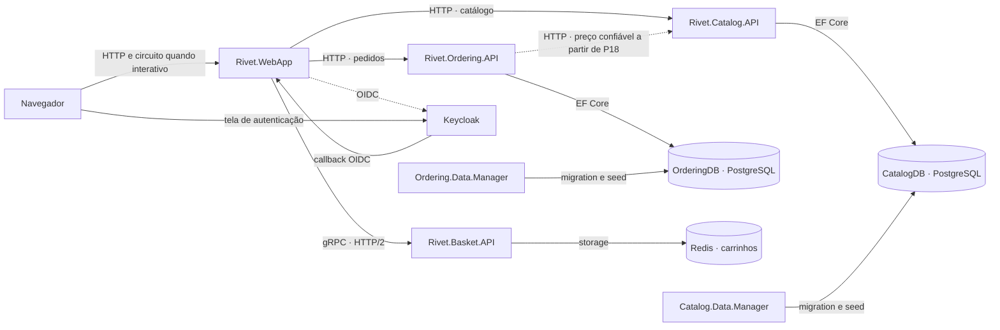

As setas contínuas de serviços representam a comunicação de negócio. OIDC não implica consulta ao IdP em cada requisição; APIs validam access tokens do emissor configurado. As bases CatalogDB e OrderingDB podem compartilhar um servidor PostgreSQL local sem compartilhar propriedade dos dados.

O AppHost descreve e inicia recursos; não funciona como gateway no caminho do navegador. ServiceDefaults fornece configuração técnica, não uma API remota de negócio.

## A2 — Dependências de projetos

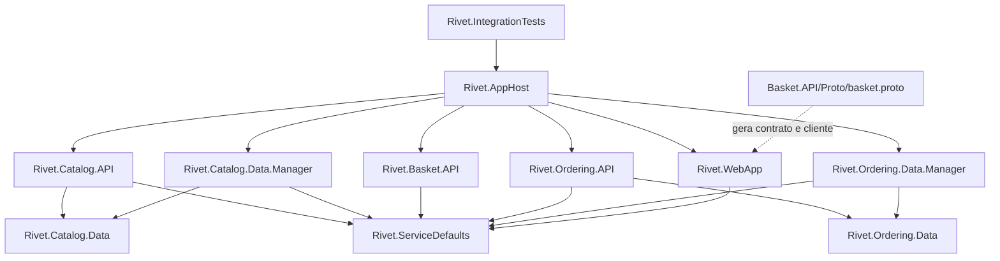

Aqui as setas representam referências de projeto ou o vínculo explícito ao contrato, não tráfego de rede. WebApp não referencia Catalog.Data/Ordering.Data. A integração de preço adicionada em P18 também é HTTP: não cria ProjectReference de Ordering.Data para Catalog.Data.

`Shared` será uma pasta de helpers pequenos compilados pelos managers conforme necessário, como no exemplo; não é um projeto de entidades compartilhadas entre os serviços.

## A3 — Estrutura física planejada

As pastas abaixo serão criadas quando a entrega correspondente precisar delas. Nomes e organização interna podem ser refinados com uma justificativa registrada, preservando os IDs dos passos.

```text
Rivet/
├── Rivet.slnx
├── global.json
├── Directory.Build.props
├── .editorconfig                         # convenções do Rivet, quando definidas
├── .gitignore
├── AGENTS.md
├── docs/
│   └── PLANO-DE-DESENVOLVIMENTO.md
├── src/
│   ├── Rivet.AppHost/                    # P06; recursos evoluem por entrega
│   │   ├── Program.cs
│   │   └── KeycloakResource.cs           # P10, se necessário à integração atual
│   ├── Rivet.ServiceDefaults/            # P06; configuração técnica
│   │   ├── HostingExtensions.cs
│   │   ├── OpenApiExtensions.cs
│   │   ├── ConfigurationExtensions.cs
│   │   ├── ServiceDiscoveryExtensions.cs
│   │   ├── AuthenticationExtensions.cs   # P10/P11
│   │   ├── ClaimsPrincipalExtensions.cs
│   │   └── HttpClientExtensions.cs
│   ├── Rivet.Catalog.API/                # P01
│   │   ├── Program.cs
│   │   ├── Apis/CatalogApi.cs
│   │   ├── Extensions/HostingExtensions.cs
│   │   ├── Model/
│   │   │   ├── CatalogServices.cs
│   │   │   ├── PaginationRequest.cs
│   │   │   └── PaginatedItems.cs
│   │   ├── CatalogOptions.cs
│   │   └── Pics/
│   ├── Rivet.Catalog.Data/               # P02
│   │   ├── CatalogBrand.cs
│   │   ├── CatalogType.cs
│   │   ├── CatalogItem.cs
│   │   ├── CatalogDbContext.cs
│   │   └── EntityConfigurations/
│   ├── Rivet.Catalog.Data.Manager/       # P02
│   │   ├── Program.cs
│   │   ├── CatalogContextSeed.cs
│   │   └── Migrations/
│   ├── Rivet.WebApp/                     # P07
│   │   ├── Program.cs
│   │   ├── Extensions/
│   │   ├── Components/
│   │   │   ├── App.razor
│   │   │   ├── Routes.razor
│   │   │   ├── Layout/
│   │   │   ├── Catalog/                 # contratos e componentes do catálogo
│   │   │   ├── Item/
│   │   │   └── Pages/
│   │   │       ├── Catalog/
│   │   │       ├── Item/
│   │   │       ├── User/
│   │   │       ├── Cart/
│   │   │       └── Checkout/
│   │   ├── Services/
│   │   │   ├── CatalogService.cs
│   │   │   ├── IProductImageUrlProvider.cs
│   │   │   ├── ProductImageUrlProvider.cs
│   │   │   ├── LogOutService.cs
│   │   │   ├── BasketService.cs
│   │   │   ├── BasketState.cs
│   │   │   ├── BasketItem.cs
│   │   │   ├── BasketCheckoutInfo.cs
│   │   │   └── OrderingService.cs
│   │   └── wwwroot/
│   ├── Keycloak/data/import/             # P10; sem credenciais reais
│   ├── Rivet.Basket.API/                 # P11
│   │   ├── Program.cs
│   │   ├── Proto/basket.proto
│   │   ├── Grpc/BasketService.cs
│   │   ├── Model/
│   │   ├── Storage/IBasketStore.cs
│   │   ├── Storage/RedisBasketStore.cs
│   │   └── Extensions/
│   ├── Rivet.Ordering.API/               # P15
│   │   ├── Program.cs
│   │   ├── Apis/OrdersApi.cs
│   │   ├── Model/
│   │   ├── Services/IIdentityService.cs
│   │   ├── Services/IdentityService.cs
│   │   ├── Services/OrderCreationService.cs # somente se extraído em P18
│   │   └── Extensions/
│   ├── Rivet.Ordering.Data/              # P15
│   │   ├── Order.cs
│   │   ├── OrderItem.cs
│   │   ├── Buyer.cs
│   │   ├── Address.cs
│   │   ├── ValueObject.cs
│   │   ├── PaymentMethod.cs              # pagamento fictício adaptado
│   │   ├── CardType.cs
│   │   ├── Enumeration.cs
│   │   ├── OrderStatus.cs
│   │   ├── OrderingDbContext.cs
│   │   ├── OrderRequest.cs               # complemento P19
│   │   └── EntityConfigurations/
│   ├── Rivet.Ordering.Data.Manager/      # P15
│   │   ├── Program.cs
│   │   ├── OrderingDbContextSeed.cs
│   │   └── Migrations/
│   ├── Shared/
│   │   ├── MigrateDbContextExtensions.cs
│   │   └── ActivityExtensions.cs
│   └── Rivet.IntegrationTests/           # P06; acompanha novas entregas
│       ├── Infrastructure/
│       ├── WebAppTests.cs
│       └── testes por comportamento
└── .github/workflows/ci.yml              # P24
```

Cada diretório de projeto contém seu `.csproj` e configurações pertinentes, omitidos acima para facilitar a leitura. Arquivos de infraestrutura/deployment em P26 serão produzidos pelo mecanismo escolhido e revisados: não definir uma pasta `infra` ou manifestos fictícios antes de confirmar o fluxo atual.

### Contratos HTTP que devem existir ao final da base

Base do catálogo: `/api/v1/catalog`.

| Método e rota | Função | Passo |
| --- | --- | --- |
| `GET /catalogbrands` | Marcas | P02 |
| `GET /catalogtypes` | Tipos | P02 |
| `GET /items` | Lista paginada | P03 |
| `GET /items/{id:int}` | Detalhe | P03 |
| `GET /items/by?ids=1&ids=2` | Consulta por IDs | P04 |
| `GET /items/by/{name:minlength(1)}` | Prefixo de nome | P04 |
| `GET /items/type/{typeId}/brand/{brandId?}` | Tipo e marca opcional | P04 |
| `GET /items/type/all/brand/{brandId:int?}` | Marca | P04 |
| `GET /items/{catalogItemId:int}/pic` | Imagem | P05 |
| `POST /api/v1/orders/` | Criar pedido autenticado | P15; reforços P18/P19 |
| `GET /api/v1/orders/` | Pedidos da identidade corrente | P15 |

As duas últimas rotas já incluem a base de pedidos, não devem ser prefixadas com a base de catálogo. Rotas públicas web: `/`, `/item/{itemId:int}` e `/product-images/{id}`. Rotas de identidade: `/user/login`, `/user/logout`. Rotas web protegidas: `/cart`, `/checkout` e `/user/orders`.

O contrato de carrinho é gRPC: `package BasketApi`, serviço `Basket`, métodos `GetBasket`, `UpdateBasket`, `DeleteBasket`. Caminho completo de um método: `/BasketApi.Basket/GetBasket`. Mensagens de request/response são geradas do `.proto`; UpdateBasket recebe itens com `product_id` e `quantity`. Não passar um BuyerId arbitrário para selecionar o carrinho de outra pessoa.

Em P20, como complemento explícito, o contrato passa a transportar a versão do carrinho e a versão esperada na exclusão; o store compara e exclui atomicamente. O `.proto` original tem request de exclusão vazio, portanto essa evolução precisa ser explicada e testada no cliente e no servidor.

## C1 — Classes do catálogo

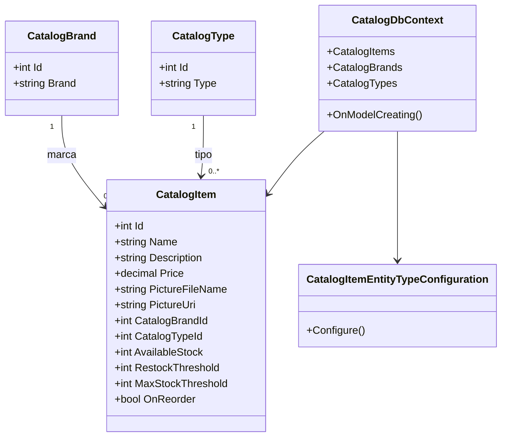

O diagrama resume campos e relações; navegações e DbSets completos serão explicados ao criar cada classe. Na referência, FK não anulável define associação obrigatória, mesmo com navegação C# anotada como nullable. `PictureUri` é calculada e não persistida; `virtual` sozinho não ativa lazy loading. Os records de resposta da WebApp são tipos de transporte próprios, mesmo quando repetem nomes das entidades.

## C2 — Carrinho, armazenamento e clientes

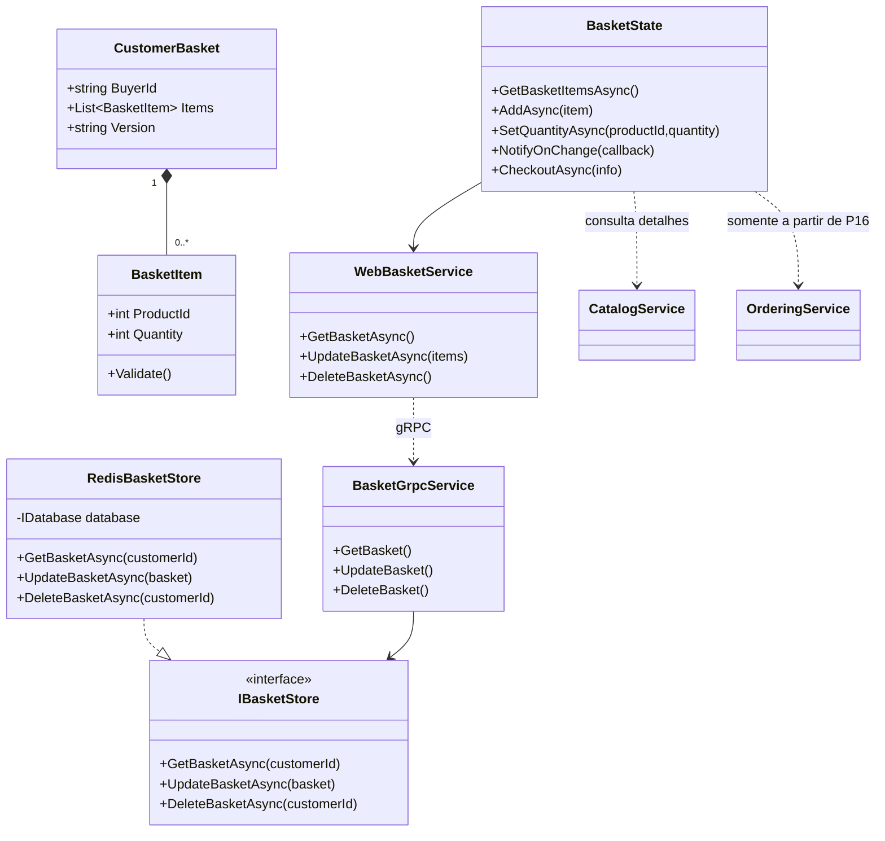

`BasketGrpcService` e `WebBasketService` são rótulos explicativos do diagrama; no código da referência ambos se chamam `BasketService`, em namespaces diferentes. O contrato protobuf possui seu próprio `BasketItem` só com ID/quantidade. O modelo de storage da referência tem campos adicionais; o transporte e a interface não precisam compartilhar sua classe.

A chave Redis é por identidade, como `/basket/{subject}`. No exemplo, UpdateBasket substitui o documento inteiro e não configura versão/TTL. Isso pode perder atualizações simultâneas de abas; P13 demonstra a limitação e a registra. O campo `Version` será acrescentado em P20 para proteger a limpeza após checkout; isso não é um controle otimista completo de todas as atualizações.

## C3 — Pedidos e pagamento fictício

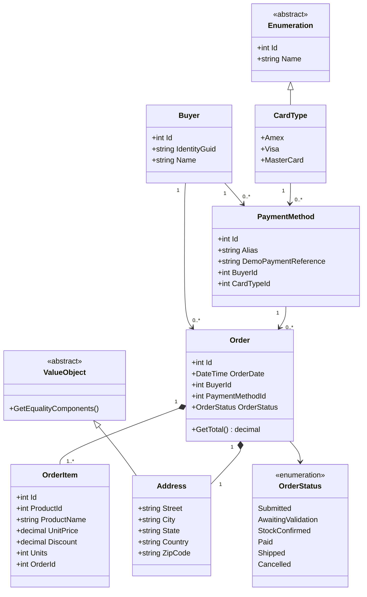

O diagrama é o **alvo do Rivet**, com pelo menos um item validado, associações obrigatórias no fluxo de criação e pagamento fictício adaptado. A referência permite coleção vazia e algumas FKs nullable; esses detalhes não serão copiados sem discussão.

`DemoPaymentReference` é complemento do Rivet em substituição aos campos sensíveis do original. `CardType` continua útil para estudar a classe de enumeração, sem representar uma autorização real de pagamento. O estado inicial do pedido é Submitted; não há motor de logística/cobrança que execute os demais estados automaticamente.

`OrderItem.ProductId` identifica um produto de outro contexto, mas não cria FK para CatalogDB. O pedido guarda o nome/preço confirmados no momento da compra. `Address` usa igualdade por valor e owned mapping. A estrutura não será chamada de agregado rico sem realmente proteger suas invariantes.

Contratos de entrada/saída: `CreateOrderRequest`, `OrderSummary` e o record web `OrderRecord`. `OrderServices` agrupa contexto e identidade; `IIdentityService` obtém a identidade do contexto autenticado.

## C4 — Identidade e contexto do usuário

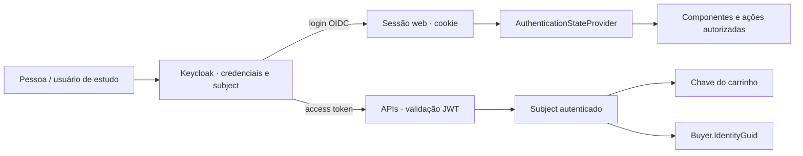

O token de acesso é enviado pelo cliente servidor para APIs, não utilizado como substituto do cookie em todas as interações do navegador. O armazenamento/propagação precisam respeitar SSR e circuito interativo: `HttpContext` não deve ser presumido válido em todo evento Blazor. Ocultar um botão não substitui autorização na API.

Microsoft Entra ID e identidade gerenciada Azure são assuntos relacionados de estudo, mas têm propósitos/configurações distintos. Trocar o IdP não é um requisito silencioso deste plano.

## C5 — Registro adicional de idempotência

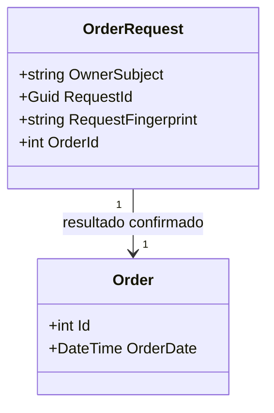

O diagrama representa um `Order` confirmado na transação. O registro de requisição é complemento de P19. Definir unicidade por identidade/chave e gravar associação/resultado atomicamente com o pedido. Durante processamento, a implementação pode precisar de campos/estados adicionais; isso será projetado e testado em P19.

O fingerprint usa uma representação canônica do conteúdo da solicitação. Uma repetição válida recupera o resultado original; não recalcula um novo pedido só porque o preço do catálogo mudou após a primeira confirmação. Duas requisições concorrentes precisam produzir um único resultado confirmado.

## F1 — Consulta de catálogo

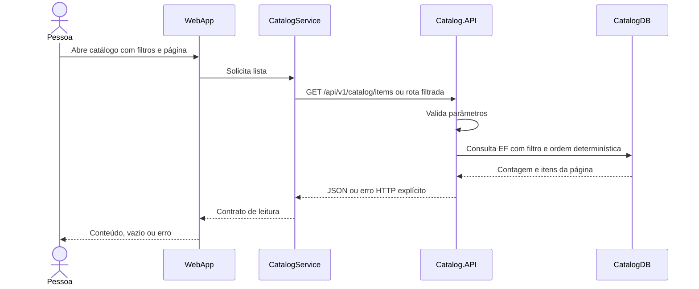

## F2 — Imagem de produto

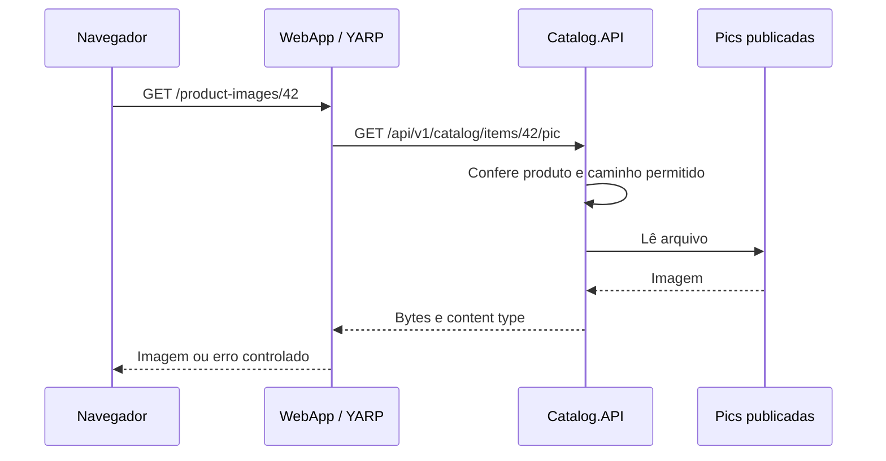

## F3 — Login e logout

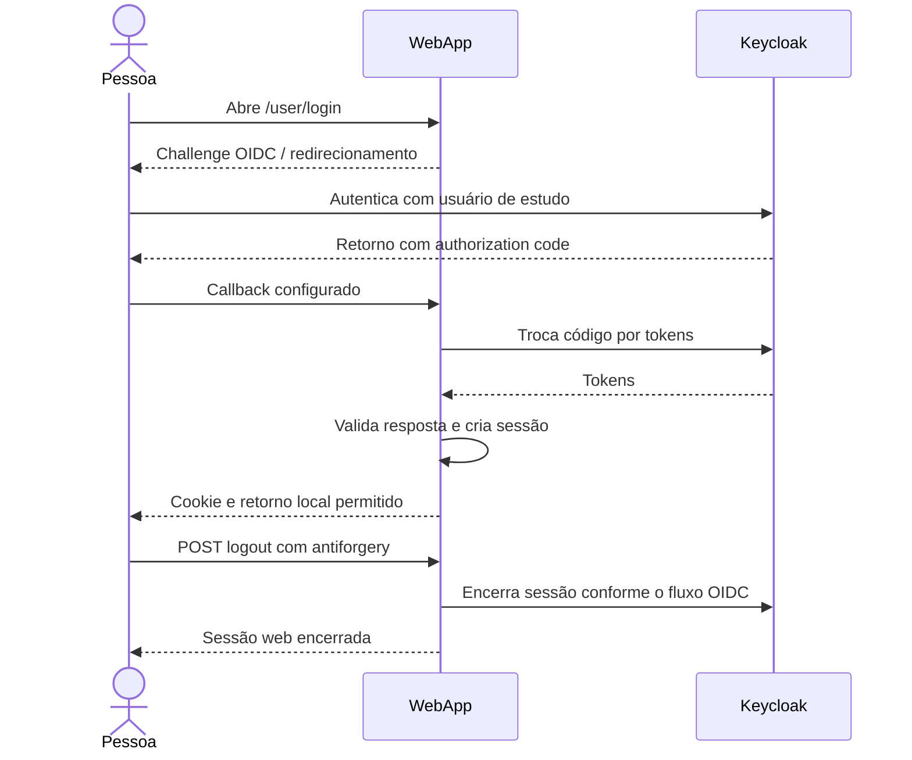

Detalhes como PKCE, proteção de estado/nonce, configuração de callbacks e transporte seguro serão explicados na implementação com a documentação da versão utilizada.

## F4 — Atualização do carrinho

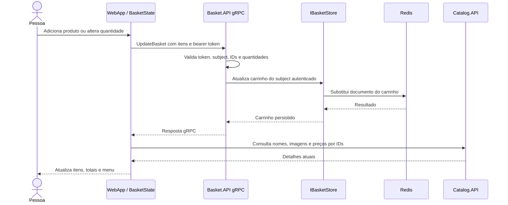

Falhas precisam ser refletidas na interface; não atualizar o estado como se o write remoto tivesse funcionado. Apagar o carrinho é um RPC separado. Preços exibidos no carrinho não substituem a confirmação do servidor na criação do pedido.

## F5 — Checkout funcional e histórico

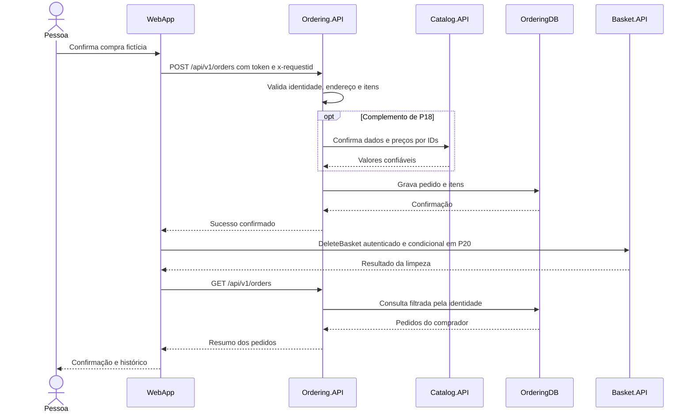

Antes de P19/P20, o fluxo já precisa verificar o sucesso HTTP e preservar carrinho em falha do POST. P19 acrescenta deduplicação; P20 acrescenta recuperação explícita quando o pedido foi confirmado e a limpeza falhou.

## F6 — Repetição e falha parcial

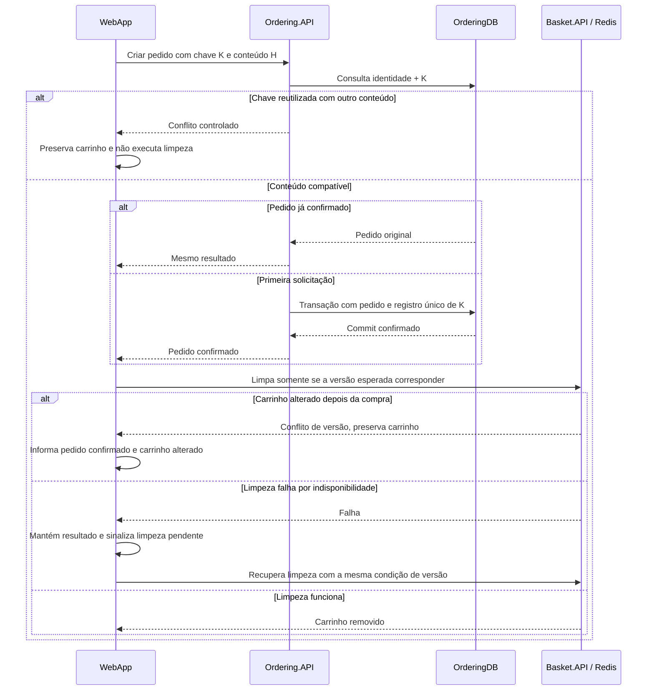

O desenho não é uma transação distribuída. A unicidade em banco precisa ser testada sob concorrência, não apenas com duas requisições sequenciais. Após confirmação, uma falha de transporte não autoriza gerar outra chave e outro pedido automaticamente.

## F7 — Rate limiting HTTP

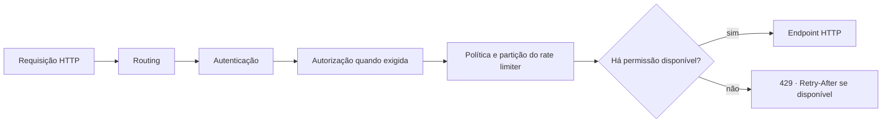

Este é um recorte do pipeline, não a lista completa de middleware. A política por endpoint exige routing anterior; partição por usuário depende de autenticação anterior. Configurar 429 explicitamente, pois o comportamento padrão não deve ser presumido. A escolha de fila/janela influencia o teste e a disponibilidade de Retry-After.

O limiter local mantém estado por processo/réplica. Quando houver escala, explicar essa fronteira; uma quota global pode exigir outro desenho. Rejeição de RPC gRPC é assunto separado, com semântica de status própria.

## A4 — Alvo de publicação no Azure

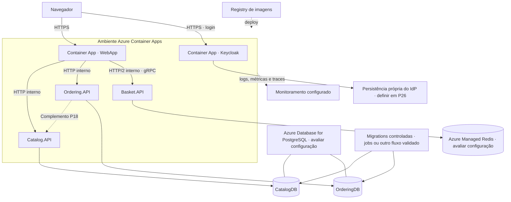

É um **alvo sujeito à validação em P26**, não um conjunto de recursos já provisionados. Componentes do IdP também precisam de configuração de rede/ambiente adequada. Container Apps é a opção planejada para estudar a composição; escolhas de SKU, região e mecanismo de deploy dependem da disponibilidade e das condições atuais.

Web/IdP precisam ser alcançados pelo navegador nos fluxos previstos. As APIs podem usar ingress interno. Basket exige HTTP/2; não basta presumir que qualquer ingress atende gRPC. Evitar `localhost` como endereço entre containers.

Assets do catálogo serão inicialmente publicados na imagem da API, com acesso consistente em todas as réplicas. Armazenamento Blob pode ser uma extensão de estudo futura; não é um serviço presente no workshop que precisa ser inventado agora.

Planejar antes de escalar: Data Protection, session affinity do Interactive Server quando aplicável, persistência do Keycloak, TLS, issuer público, segredos/conexões, readiness e migrations. O AppHost não é publicado como um servidor que precisa encaminhar todas as requisições da aplicação.

## Relação com a AZ-900

| Prática | Conceitos que vamos relacionar |
| --- | --- |
| Containers locais e ACA | Opções de computação e modelo de responsabilidade |
| Serviços com dados separados | Recursos, rede, endpoints e responsabilidade pelos dados |
| PostgreSQL/Redis gerenciados | Serviços gerenciados, disponibilidade e fatores de custo |
| Login e acesso às APIs | Identidade, autenticação e autorização; comparar com Entra sem trocar o IdP automaticamente |
| Telemetria e probes | Monitoramento e diagnóstico; comparação com Azure Monitor/Application Insights |
| IaC e ciclo de implantação | Resource Manager, grupos de recursos, governança e ferramentas de gerenciamento |
| Escala, revisão e remoção | Escalabilidade, confiabilidade, custos, tags e ciclo de vida |

Implementar esses recursos aprofunda desenvolvimento além do escopo conceitual da certificação. Os tópicos restantes da AZ-900 continuarão no Microsoft Learn, conforme o [guia oficial](https://learn.microsoft.com/credentials/certifications/resources/study-guides/az-900).
