# Plano de desenvolvimento do Rivet

Versão 2 — consolidado em 2026-10-24. Trinta passos com identificadores permanentes, de **P01** a **P30**.

## Progresso

- **Passo atual:** P01 — solução e primeira API executável.
- **Estado:** Em andamento.
- **Último concluído:** nenhum passo deste plano teve o aceite completo confirmado.
- **Próxima ação:** aluno executar a tarefa P01: criar solução/SDK fixado e API mínima, implementar GET `/api/v1/catalog/status`, executar e conferir HTTP/OpenAPI.
- **Evidência atual:** `Rivet.Catalog.API/Program.cs` já contém o endpoint `/api/v1/catalog/status` e OpenAPI em Development; `launchSettings.json` possui perfis HTTP/HTTPS. Execução HTTP/OpenAPI ainda sem resultado confirmado; P01 em implementação pelo aluno.
- **Pendências do ambiente:** última checagem em 2026-10-24 encontrou SDK ativo 10.0.401 e também SDK 8.0.424; Docker/Podman não foram localizados. Preparar containers em P02.

Estados: Pendente, Em andamento, Aguardando verificação e Concluído. Manter no máximo um passo ativo. Atualizar esta seção e a coluna Estado do índice com base em arquivos/resultados observados ou relatados pelo aluno. Anotar evidências e dúvidas no registro abaixo; não presumir compreensão ou execução.

**Registro breve:**

- 2026-10-24: escolhido reconstruir o workshop do zero pelo aluno, com o agente como instrutor; diagramas e fontes oficiais acompanham as entregas.
- 2026-10-24: definidos P01–P30, ainda sem aceite completo de implementação confirmado. Orientações anteriores de solução/src serão aproveitadas.
- 2026-10-24: documentação reduzida a AGENTS.md e este plano; sequência, estados, referências e quinze diagramas preservados. Novos registros devem ser curtos e ligados ao passo correspondente.
- 2026-10-24: orientada a execução completa de P01 com template webapi net10.0, SDK 10.0.401/latestPatch, endpoint inicial de status, OpenAPI em desenvolvimento e perfil HTTP local. Aguardando resultados do aluno; o agente não criou ou executou a aplicação.

Acesso rápido: [P01](#p01) · [Arquitetura e diagramas](#arquitetura-e-diagramas).

## Como usar este plano

O aluno implementa e executa; o agente explica, desenha, orienta e revisa. Cada passo é uma entrega coesa, com resultado utilizável ou verificável ao final. Um passo pode conter várias alterações necessárias à mesma entrega; somente um passo fica em andamento por vez.

Ao retomar, consultar o progresso no início deste arquivo, ler o passo atual e os diagramas pertinentes. Este plano concentra sequência, acompanhamento, decisões técnicas, arquitetura e referências; o AGENTS.md define o modo de instrução.

Para cada passo: explicar conceitos e escolhas → mostrar o diagrama pertinente → orientar uma tarefa prática integrada → aluno executar → revisar arquivos e resultados → registrar evidência e concluir. Trechos de código são apoio à explicação, não uma solução completa aplicada pelo agente.

**“Próximo passo” significa:** avançar de P03 para P04 se P03 estiver concluído. Se o atual ainda estiver pendente ou sem verificação, retomar sua entrega e identificar o que falta. Não declarar conclusão por ter apresentado o conteúdo. Evidência pode ser a inspeção de arquivos e/ou o resultado informado pelo aluno.

Não renumerar passos existentes. Ajustes entram no conteúdo do mesmo passo ou como complemento identificado, por exemplo P19-A; não iniciar esse complemento junto com outro passo. Não repetir trabalho já feito: no início de P01, reconciliar os arquivos existentes com o aceite do passo.

## Referência e escolhas do planejamento

- Referência de código: `src/` do [commit 3fcdc98f1fcc6f808fd77fe612e39deca6859550][W-src], consultado junto aos checkpoints de `labs/`.
- **Referência:** funcionalidades observadas no workshop. **Adaptação:** mudança de nomes, versões ou sequência interna necessária à reconstrução do zero. **Complemento:** melhoria que não está implementada no exemplo.
- O workshop entrega partes prontas. Vamos reconstruí-las em fatias completas. A ordem temática permanece catálogo → Blazor → identidade → carrinho → pedidos → resiliência → publicação.
- Nome da solução: `Rivet.slnx`. Prefixo dos projetos: `Rivet`. Framework planejado: .NET 10; SDK, versões compatíveis de EF/Npgsql/Aspire e imagens serão conferidos e fixados na etapa de utilização. Não copiar pacotes RC ou comandos históricos automaticamente.
- APIs HTTP usam **Minimal APIs**, como o workshop. O carrinho usa **gRPC**. Não acrescentar controllers, repository genérico, MediatR ou domain services por obrigação de nomenclatura. Um serviço próprio só será extraído quando houver uma responsabilidade concreta a explicar.
- A referência usa EF Core diretamente em catálogo/pedidos e `IBasketStore` no carrinho. `CatalogServices`/`OrderServices` agrupam dependências; não são serviços de domínio.
- O alvo inclui Blazor, PostgreSQL, Redis, Keycloak, Aspire e a jornada de compra simulada. Não inclui cobrança real, e-mail, gestão administrativa de catálogo nem execução dos estados de logística apenas por existirem no enum.
- Pagamentos serão uma **simulação explícita**. Adaptar os campos sensíveis do exemplo para uma referência fictícia de pagamento; não coletar ou armazenar número de cartão/CVV reais.
- Rate limiting, deduplicação real de pedidos, recuperação de falhas parciais, testes ampliados e desenho Azure são complementos identificados. O lab 6 só tem `src`; o lab 7 não tem pasta neste commit.

## Índice de entregas

| Passo | Entrega funcional | Origem | Estado |
| --- | --- | --- | --- |
| [P01](#p01) | Solução e primeira API executável | Preparação / lab 1 | Em andamento |
| [P02](#p02) | Marcas e tipos consultáveis no PostgreSQL | Lab 1, reconstrução das partes prontas | Pendente |
| [P03](#p03) | Produtos persistidos, listagem e detalhe | Lab 1 | Pendente |
| [P04](#p04) | Consultas, filtros e paginação consistentes | Lab 1 / checkpoint inicial do lab 2 | Pendente |
| [P05](#p05) | Imagens dos produtos pela API | Lab 1 / checkpoint inicial do lab 2 | Pendente |
| [P06](#p06) | Catálogo completo iniciado e observado pelo Aspire | Lab 1 | Pendente |
| [P07](#p07) | Vitrine Blazor consumindo catálogo e imagens reais | Lab 2 | Pendente |
| [P08](#p08) | Filtros e paginação navegáveis na vitrine | Lab 2 | Pendente |
| [P09](#p09) | Página de detalhe e navegação do catálogo | Lab 2 | Pendente |
| [P10](#p10) | Login/logout completo com Keycloak e OIDC | Lab 3 | Pendente |
| [P11](#p11) | Carrinho gRPC autenticado e persistido no Redis | Lab 4 | Pendente |
| [P12](#p12) | Adicionar e visualizar produtos no carrinho pela web | Lab 4 | Pendente |
| [P13](#p13) | Alterar quantidades, remover e limpar carrinho | Lab 4 | Pendente |
| [P14](#p14) | Isolamento de usuários e sessão do carrinho verificados | Lab 3/4 + complemento | Pendente |
| [P15](#p15) | Criar e consultar pedidos persistidos pela API | Lab 5 | Pendente |
| [P16](#p16) | Checkout funcional pela interface | Lab 5 | Pendente |
| [P17](#p17) | Histórico dos pedidos do usuário | Lab 5 | Pendente |
| [P18](#p18) | Checkout com valores e regras confirmados no servidor | Complemento do lab 5 | Pendente |
| [P19](#p19) | Criação idempotente de pedidos | Complemento de resiliência | Pendente |
| [P20](#p20) | Recuperação de falhas parciais no checkout | Complemento de resiliência | Pendente |
| [P21](#p21) | Timeouts e resiliência HTTP/gRPC testados com falhas | Lab 6 + complemento | Pendente |
| [P22](#p22) | Rate limiting HTTP com rejeição verificável | Complemento solicitado | Pendente |
| [P23](#p23) | Diagnóstico completo, health checks e telemetria | ServiceDefaults + complemento | Pendente |
| [P24](#p24) | Regressão distribuída e pipeline de verificação | IntegrationTests + complemento | Pendente |
| [P25](#p25) | Jornada completa em artefatos publicados localmente | Preparação de publicação | Pendente |
| [P26](#p26) | Infraestrutura Azure revisada e validada | Complemento do lab 7 ausente | Pendente |
| [P27](#p27) | Ambiente completo de estudo publicado no Azure | Complemento do lab 7 ausente | Pendente |
| [P28](#p28) | Reinício e escala com identidade e dados preservados | Complemento de operação | Pendente |
| [P29](#p29) | Atualização, rollback e acompanhamento do ambiente | Complemento de operação | Pendente |
| [P30](#p30) | Encerramento dos recursos e revisão de aprendizado | Ciclo de estudo / AZ-900 | Pendente |

## Entregas detalhadas

### P01

**Solução e primeira API executável.** Origem: preparação do lab 1; adaptação para uma primeira entrega executável. Pré-requisito: SDK disponível.

1. Conferir se já existem solução e arquivos do aluno; aproveitar o que corresponde ao plano. Definir `.NET 10`, namespace e o padrão de nomes.
2. Criar `Rivet.slnx`, a pasta `src` e `Rivet.Catalog.API`, uma aplicação ASP.NET Core com Minimal APIs; adicioná-la à solução.
3. Fixar a política do SDK em `global.json` após explicar SDK versus framework alvo. Habilitar nullable e definir as convenções iniciais de build sem instalar toda a arquitetura.
4. Criar uma resposta HTTP inicial identificando o catálogo e verificar o documento OpenAPI em desenvolvimento. Esse endpoint inicial é apenas a primeira verificação da aplicação.

**Pronto quando:** o aluno executar a API, fizer uma requisição e observar status 200 e o conteúdo esperado; a solução listar esse projeto. Registrar o endereço realmente usado. Um build isolado não substitui a chamada HTTP.

**Conceitos e desenho:** solução versus projeto, biblioteca versus aplicação executável, `Program.cs`, host e primeiro endpoint. Diagramas A1/A2 da [arquitetura](#arquitetura-e-diagramas).

**Fontes:** [soluções][M-sln], [Minimal APIs][M-api] e [lab 1][W-lab1].

### P02

**Marcas e tipos persistidos e consultáveis.** Origem: Data/Manager que o lab 1 fornece prontos. Pré-requisito: P01.

1. Preparar e validar um runtime de containers compatível com a máquina. Iniciar PostgreSQL e pgAdmin com imagem fixada e configuração local por segredo; limitar a exposição local. Não reproduzir autenticação `trust` como padrão.
2. Criar `Rivet.Catalog.Data` com `CatalogBrand`, `CatalogType`, `CatalogDbContext` e os dois mapeamentos `IEntityTypeConfiguration`. Usar schema `catalog`.
3. Criar `Rivet.Catalog.Data.Manager` com a primeira migration e seed idempotente de marcas/tipos; reconstruir somente o helper de inicialização necessário agora em `Shared`.
4. Ligar a API ao contexto e implementar `GET /api/v1/catalog/catalogbrands` e `GET /api/v1/catalog/catalogtypes` com ordenação e consultas assíncronas.

**Pronto quando:** manager criar o schema e os dados; ambos os endpoints devolverem registros reais; reiniciar API/manager não duplicar o seed nem apagar dados. Conferir também as tabelas no banco.

**Conceitos e desenho:** conexão, DI e escopo do DbContext, entidade, chave, migration e seed; diagrama C1 e fluxo F1. Esta etapa termina com banco → EF → HTTP funcionando.

**Fontes:** [modelo EF][M-model], [DbContext][M-context], [migrations][M-migrations] e [lab 1][W-lab1].

### P03

**Produtos persistidos com lista e detalhe.** Origem: catálogo da referência. Pré-requisito: P02.

1. Implementar `CatalogItem`, seus relacionamentos com marca/tipo e todos os campos do modelo que será estudado, incluindo preço, imagem e estoque informativo.
2. Criar `CatalogItemEntityTypeConfiguration`: tabela `Catalog`, tamanho do nome, índice e `PictureUri` calculada/ignorada na persistência. Gerar migration incremental e seed pequeno de produtos.
3. Implementar `GET /items` e `GET /items/{id:int}` sob `/api/v1/catalog`, usando `PaginationRequest`, `PaginatedItems<TItem>` e resultados tipados.
4. Definir tamanho máximo/default da página, ordenação determinística e tratamento de ID inválido/inexistente desde esta primeira versão.

**Pronto quando:** listar e consultar produto por ID retornarem dados do PostgreSQL; ID inválido resultar em 400 e inexistente em 404; marca/tipo relacionados estiverem coerentes. Nomes de propriedades não devem depender de lazy loading implícito.

**Conceitos e desenho:** C1 e F1; FKs versus navegações, nulabilidade, `decimal`, tracking e projeção do contrato. Estoque ainda é dado do catálogo, não uma reserva de compra.

**Fontes:** [relacionamentos][M-relations], [paginação][M-pagination] e [API final][W-catalog-api].

### P04

**Consultas completas do catálogo.** Origem: catálogo final e código já acrescentado na entrada do lab 2. Pré-requisito: P03.

1. Implementar busca por IDs (`/items/by`), prefixo de nome (`/items/by/{name}`), tipo/marca e somente marca nas rotas da referência.
2. Reaproveitar a composição LINQ quando isso melhorar clareza; contagem e resultados devem aplicar os mesmos filtros.
3. Uniformizar validação de parâmetros, ordenação com desempate único e erros de entrada. Refatorar o mapa de rotas em `Apis/CatalogApi.cs` e registros em `Extensions/HostingExtensions.cs` se ainda estiverem concentrados.

**Pronto quando:** cada rota do catálogo listada em A3 devolver o conjunto correto; paginação filtrada não perder/repetir itens por falta de ordenação; uma lista sem resultados continuar sendo uma resposta válida. Salvar exemplos de requisição reutilizáveis.

**Conceitos e desenho:** contrato de consulta, binding de coleção, filtros opcionais e ProblemDetails. `CatalogServices` pode agrupar dependências, sem se tornar uma camada de domínio artificial.

**Fontes:** [Minimal APIs][M-api], [paginação][M-pagination], [API final][W-catalog-api] e [checkpoint do lab 2][W-lab2].

### P05

**Imagens servidas pelo catálogo.** Origem: endpoint de imagem da referência. Pré-requisito: P04.

1. Adicionar um conjunto pequeno de imagens em `Rivet.Catalog.API/Pics`, respeitando a licença/origem dos assets reutilizados.
2. Implementar `CatalogOptions` e geração da URL do produto por configuração; assegurar que as imagens sejam incluídas na publicação.
3. Implementar `GET /items/{catalogItemId:int}/pic`, content type e metadados pertinentes; tratar produto/arquivo ausente e caminho inválido de forma controlada.

**Pronto quando:** uma imagem real abrir por HTTP e a URL retornada no catálogo estiver correta; arquivos ausentes gerarem resposta controlada. Não depender de um caminho absoluto da máquina do aluno.

**Conceitos e desenho:** configuração Options, arquivo versus URL e segurança do caminho; fluxo F2.

**Fontes:** [API final][W-catalog-api], [opções][M-options] e [lab 1][W-lab1].

### P06

**Catálogo composto pelo Aspire.** Origem: orquestração e defaults da referência. Pré-requisito: P05.

1. Criar `Rivet.AppHost` e `Rivet.ServiceDefaults` com versões estáveis compatíveis, conferidas nesta etapa.
2. Declarar PostgreSQL, pgAdmin, `CatalogDB`, manager e API; substituir a composição manual sem perder a configuração necessária ao ambiente de estudo.
3. Configurar referências, nomes lógicos, dependências de inicialização e readiness: uma referência sozinha não garante que migration/seed terminaram. Desde a introdução dos defaults, limitar retries a leituras ou desabilitar explicitamente retries de escrita; o handler padrão do exemplo não deve ser copiado sem essa revisão.
4. Introduzir health checks, telemetria e um primeiro smoke test em `Rivet.IntegrationTests`, isolando recursos e verificando também uma consulta real do catálogo.

**Pronto quando:** um lançamento do AppHost iniciar o recorte completo; o banco estar pronto antes da verificação funcional; requisição ao catálogo aparecer no dashboard; o aluno executar o smoke test sem afetar dados de desenvolvimento.

**Conceitos e desenho:** A1/A2, recursos versus processos, service discovery, health e traces; migrations continuam com responsabilidade própria.

**Fontes:** [AppHost final][W-apphost], [ServiceDefaults][W-defaults], [teste da referência][W-test], [testes Aspire atuais][M-aspire-tests] e [observabilidade Microsoft][M-otel].

### P07

**Vitrine Blazor com produtos e imagens reais.** Origem: início do lab 2. Pré-requisito: P06.

1. Criar `Rivet.WebApp` como Blazor Web App, registrar no AppHost e ligar ao catálogo por cliente HTTP tipado `CatalogService`.
2. Criar contratos de leitura próprios da interface em `Components/Catalog`, sem referenciar `Catalog.Data`.
3. Implementar a página `/`, layout mínimo e cards de produtos. Introduzir `IProductImageUrlProvider`, sua implementação e encaminhamento `/product-images/{id}` via YARP/discovery.
4. Implementar carregamento, vazio e erro compreensíveis. Explicar SSR/streaming e quais componentes, de fato, precisam de interatividade.

**Pronto quando:** o navegador mostrar nome, preço e imagem vindos da API/banco; indisponibilidade da API produzir estado de erro controlado. Nenhuma dependência de carrinho/pedidos ainda inexistente será exigida pelo construtor.

**Conceitos e desenho:** A1, F1/F2; contrato de transporte, typed client, renderização e separação interface/persistência.

**Fontes:** [lab 2][W-lab2], [WebApp final][W-web] e [renderização Blazor][M-render].

### P08

**Navegação de catálogo por filtros e paginação.** Origem: lab 2. Pré-requisito: P07.

1. Implementar seleção de marca/tipo e navegação entre páginas, usando os endpoints já disponíveis.
2. Representar estado na query string; ao mudar filtro, redefinir a página quando necessário.
3. Validar parâmetros vindos da URL e manter estados vazio/erro coerentes, sem transformar uma falha remota em catálogo vazio silencioso.

**Pronto quando:** copiar/reabrir uma URL preservar filtros e página; trocar marca/tipo atualizar os dados; navegar não repetir requisições desnecessárias nem permitir páginas inválidas sem tratamento.

**Conceitos e desenho:** fluxo F1 e estado navegável; diferença entre estado da URL e estado apenas em memória.

**Fontes:** [lab 2][W-lab2] e [WebApp final][W-web].

### P09

**Detalhe do produto.** Origem: desafio do lab 2 e página final. Pré-requisito: P08.

1. Implementar `Components/Pages/Item/ItemPage.razor`, rota `/item/{itemId:int}` e consulta por ID pelo `CatalogService`.
2. Ligar cards ao detalhe e mostrar descrição, marca/tipo, preço e imagem.
3. Tratar produto inexistente, endereço inválido e falha de conexão; manter navegação de retorno compreensível.

**Pronto quando:** clicar em um produto abrir seus dados reais e produto inexistente exibir um estado 404 coerente. Adicionar ao carrinho será habilitado quando essa operação existir em P12.

**Conceitos e desenho:** componentes de página, parâmetros de rota, navegação e contrato de detalhe; C1/F1.

**Fontes:** [lab 2][W-lab2] e [WebApp final][W-web].

### P10

**Login e logout completos.** Origem: lab 3. Pré-requisito: P09.

1. Compor Keycloak no AppHost, realm e cliente web; habilitar e verificar o cadastro de usuários fictícios pelo IdP, como na referência, com persistência local conhecida. Conferir integração atual em vez de copiar o recurso customizado antigo sem revisão.
2. Configurar cookie e OIDC Authorization Code no servidor; URLs de callback, issuer, segredo e retorno local permitido.
3. Implementar menu de usuário, `/user/login`, `/user/logout`, `LogOutService` e estado de autenticação do Blazor. Proteger o POST de logout contra CSRF com validação antiforgery.
4. Manter catálogo público e o login de ponta a ponta verificável. Os usuários pertencem ao IdP; não criar tabela local de senhas nem entidade User para reproduzir o workshop.

**Pronto quando:** usuário fictício cadastrar-se no provedor, entrar, voltar identificado e sair; retorno externo malicioso ser recusado; navegação anônima do catálogo continuar funcionando e outro navegador ter sessão independente. Envio de e-mail/reset de senha não é inferido desse cadastro.

**Conceitos e desenho:** C4/F3; autenticação versus autorização, cookie versus access token, identidade de comprador versus identidade gerenciada Azure.

**Fontes:** [lab 3][W-lab3], [OIDC web][M-oidc], [segurança Blazor][M-blazor-security] e [configuração web final][W-web-hosting].

### P11

**Carrinho gRPC autenticado e persistido.** Origem: lab 4. Pré-requisito: P10.

1. Criar `Rivet.Basket.API`, recurso Redis no AppHost e contrato `Proto/basket.proto` com GetBasket, UpdateBasket e DeleteBasket.
2. Implementar modelos internos, `IBasketStore`, `RedisBasketStore` e o `BasketService` servidor, com serialização e chave por usuário.
3. Configurar no realm/client scopes/mappers a emissão de access tokens para a audience do carrinho e obter um token de teste válido. Validar bearer token e identidade no servidor com issuer/audience corretos. Aplicar validação explícita de IDs/quantidades e limites do payload gRPC.
4. Testar os RPCs por cliente que importe o `.proto` e envie token; reflection não é uma premissa do exemplo.

**Pronto quando:** usuário autenticado gravar, ler e excluir seu carrinho no Redis; ausência de token for recusada; outro usuário receber seu próprio carrinho. Reiniciar a API não deve apagar o carrinho no Redis em execução.

**Conceitos e desenho:** C2/F4; HTTP/2, protobuf, código gerado, autenticação e storage de carrinho. Redis é o armazenamento desse serviço, não apenas uma otimização de consultas.

**Fontes:** [lab 4][W-lab4], [contrato final][W-proto], [implementação do carrinho][W-basket], [gRPC][M-grpc] e [JWT bearer][M-jwt].

### P12

**Adicionar e visualizar carrinho na web.** Origem: lab 4. Pré-requisito: P11.

1. Gerar cliente gRPC na WebApp a partir do contrato e implementar `Services/BasketService`, propagando token de forma compatível com o contexto Blazor.
2. Implementar a parte necessária de `BasketState` e `BasketQuantity`: quantidades vêm do carrinho; nome/preço/imagem vêm do catálogo.
3. Habilitar adicionar no detalhe e criar `/cart` protegida. Não injetar `OrderingService` antes de existir a funcionalidade de pedidos.

**Pronto quando:** entrar, adicionar produto e visualizar carrinho com nome, quantidade e preço reais; recarregar preservar o carrinho; usuário anônimo ser direcionado ao login quando tentar a ação protegida.

**Conceitos e desenho:** C2/F4; composição de dados de serviços e estado por usuário. Não confundir os tipos BasketItem do protobuf, storage e interface.

**Fontes:** [lab 4][W-lab4], [BasketState final][W-basket-state] e [cenários de segurança Blazor][M-blazor-security].

### P13

**Editar, remover e limpar carrinho.** Origem: lab 4. Pré-requisito: P12.

1. Implementar alteração de quantidade, remoção por ação explícita/quantidade zero na interface e limpeza completa.
2. Completar totais, `CartMenu`, cache local e notificações Observer; remover assinaturas ao descartar consumidores.
3. Exibir falhas remotas sem fingir sucesso e invalidar cache somente conforme o resultado da operação.

**Pronto quando:** quantidade e totais/indicador do menu se atualizarem; remover o último item mostrar carrinho vazio; falha do Redis não resultar em confirmação falsa de alteração.

**Conceitos e desenho:** C2/F4; estado derivado, subscriptions/IDisposable e substituição do documento no Redis. O exemplo não oferece controle de concorrência entre abas; documentar essa limitação e verificar seu efeito.

**Fontes:** [lab 4][W-lab4], [storage Redis][W-store] e [estado da interface][W-basket-state].

### P14

**Isolamento de usuários e sessão do carrinho.** Origem: autenticação/autorização da referência + regressões adicionais. Pré-requisito: P13.

1. Revisar proteção efetiva de página/ação/RPC, derivação do dono pelo token e propagação de credenciais no SSR/circuito em que cada chamada ocorre.
2. Garantir que logout/troca de usuário não reutilizem cache ou estado do carrinho anterior; conferir escopos de serviços.
3. Criar verificações de duas identidades, token inválido/expirado, entrada inválida e tentativa de escolher outro proprietário.

**Pronto quando:** usuário A e B permanecerem isolados, inclusive ao sair/entrar no mesmo navegador; falhas de autenticação serem apresentadas corretamente. Esta etapa reforça segurança já presente desde P10/P11, não a adia.

**Conceitos e desenho:** C4/F3/F4; autorização sobre recurso, limites de AuthorizeView e tempo de vida do estado. Papéis administrativos não são exigidos pela referência.

**Fontes:** [segurança Blazor][M-blazor-security], [JWT bearer][M-jwt] e [servidor gRPC final][W-basket].

### P15

**Pedido persistido com criação e consulta HTTP.** Origem: lab 5. Pré-requisito: P14.

1. Criar `Rivet.Ordering.Data`, `Rivet.Ordering.Data.Manager`, `Rivet.Ordering.API` e `OrderingDB` na composição.
2. Implementar o grafo necessário à operação completa: `Buyer`, `Order`, `OrderItem`, `Address : ValueObject`, `PaymentMethod` fictício, `CardType : Enumeration` e enum `OrderStatus`.
3. Implementar contexto, configurações EF, migration e seed de CardType. Buyer representa a identidade externa, com unicidade de IdentityGuid.
4. Criar `CreateOrderRequest`, `OrderSummary`, `IIdentityService`/`IdentityService`, `OrderServices` e POST/GET `/api/v1/orders`, protegidos e filtrados pelo usuário.
5. Validar dados mínimos e lista não vazia; confirmar a gravação com uma consulta. Configurar a emissão de token para a audience de pedidos. Verificar os defaults herdados e manter explicitamente desabilitado retry de criação de pedidos nesta entrega.

**Pronto quando:** POST válido com dados fictícios criar pedido e GET do mesmo usuário retorná-lo; outro usuário não vê-lo; entrada inválida não gravar. Dados enviados pelo cliente ainda serão aprofundados em P18, sem uso comercial antes disso.

**Conceitos e desenho:** C3/F5; Value Object, classe de enumeração versus enum comum, owned type, transação local do EF e contrato de saída. Os estados do enum não significam que todos os seus processos existem.

**Fontes:** [lab 5][W-lab5], [API final de pedidos][W-orders], [modelo final][W-order-data] e [persistência Microsoft][M-persistence].

### P16

**Checkout pelo site.** Origem: lab 5. Pré-requisito: P15.

1. Criar `BasketCheckoutInfo`, formulário `/checkout`, validações de endereço e pagamento simulado claramente identificado.
2. Implementar `OrderingService` HTTP e completar a parte de checkout em `BasketState`, preservando uma chave de requisição durante a tentativa.
3. Verificar o status e tratar a resposta do POST antes de informar sucesso ou apagar carrinho; descartar a resposta HTTP quando adequado.
4. Proteger a página e navegação, evitar submissão concorrente pelo botão e apresentar confirmação/erro utilizável.

**Pronto quando:** comprar a partir de um carrinho válido criar um pedido e limpar o carrinho após confirmação; HTTP 400/500 preservar os itens e exibir erro. Duplo clique bloqueado na UI não será chamado de idempotência do servidor.

**Conceitos e desenho:** F5; validação da UI versus servidor e coordenação sequencial de chamadas.

**Fontes:** [lab 5][W-lab5], [BasketState][W-basket-state] e [cliente final de pedidos][W-order-client].

### P17

**Histórico de pedidos do usuário.** Origem: página final `/user/orders`. Pré-requisito: P16.

1. Implementar `OrderRecord` no cliente, consulta pelo `OrderingService` e página protegida de histórico com data, estado e total.
2. Ligar confirmação de checkout/menu ao histórico e tratar vazio, carregamento e erro.
3. Conferir leitura sem tracking e projeção para `OrderSummary`, mantendo valores monetários consistentes no contrato (não perder precisão na interface).

**Pronto quando:** uma compra aparecer no histórico do comprador e não no de outro usuário; sessão anônima seguir o fluxo de autenticação. A jornada básica catálogo → login → carrinho → pedido → histórico está completa.

**Conceitos e desenho:** C3/F5; projeção, contrato independente de entidade e escopo da identidade.

**Fontes:** [WebApp final][W-web] e [API de pedidos][W-orders].

### P18

**Regras e valores do checkout confirmados no servidor.** Origem: complemento explícito. Pré-requisito: P17.

1. Revisar quantidades/limites, carrinho vazio, produtos ausentes e pagamento fictício nas fronteiras HTTP e gRPC; não presumir que atributos de validação sejam executados automaticamente nos RPCs.
2. Acrescentar integração de Ordering.API com Catalog.API por contrato e referência de recurso. Confirmar nome/preço dos produtos em fonte confiável no servidor, recalculando total.
3. Extrair um serviço de aplicação, por exemplo `OrderCreationService`, somente se ajudar a coordenar validação/consultas sem tornar o handler extenso. Explicar essa adaptação; o serviço não é obrigatório na referência.
4. Definir comportamento quando o preço muda ou produto não existe e verificar o fluxo com payload adulterado.

**Pronto quando:** alterar preço/nome no payload não permitir forjar o pedido; entradas inválidas não gerarem gravação parcial; catálogo indisponível produzir falha controlada. Isso não implementa reserva de estoque nem pagamento real.

**Conceitos e desenho:** F5, seta complementar Ordering → Catalog em A1 e fronteiras de confiança.

**Fontes:** [API do exemplo e sua limitação][W-orders], [validação Minimal API][M-api] e [desenho por complexidade][M-ddd].

### P19

**Pedido idempotente e verificação concorrente.** Origem: complemento; `x-requestid` no exemplo não deduplica. Pré-requisito: P18.

1. Definir contrato de repetição: mesma identidade/chave e mesmo conteúdo retorna o mesmo resultado; mesma chave com conteúdo diferente é conflito.
2. Persistir um registro de requisição (`OrderRequest`) associado ao comprador/chave, fingerprint e resultado; usar unicidade e atomicidade na mesma base do pedido. Gerar a migration.
3. Tratar concorrência e rollback sem deixar uma chave marcada como concluída para um pedido que não foi confirmado; não usar somente cache em memória.
4. Adaptar o retorno do POST/cliente para reconhecer o pedido confirmado. Preservar a mesma chave em uma repetição da mesma compra.

**Pronto quando:** repetir a requisição, inclusive em paralelo, criar um único pedido e devolver resultado consistente; trocar o conteúdo reutilizando a chave causar conflito controlado. Timeout depois de gravar não deve levar a nova compra automática com outra chave.

**Conceitos e desenho:** C5/F6; idempotência, restrição única, transação local e falha de comunicação depois do commit.

**Fontes:** [limitação do endpoint original][W-orders], [persistência][M-persistence] e [efeitos dos retries][M-resilience].

### P20

**Recuperação de falha parcial no checkout.** Origem: complemento. Pré-requisito: P19.

1. Distinguir no estado da interface: pedido não confirmado, confirmado com limpeza pendente e finalizado. Preservar o snapshot da compra e sua chave separadamente do carrinho que pode continuar sendo editado.
2. Acrescentar um token de versão do carrinho renovado em cada escrita e devolvido no contrato; evoluir o RPC DeleteBasket com a versão esperada. Fazer comparação e exclusão atômicas no Redis.
3. Se a gravação funcionar e a limpeza falhar, informar o pedido confirmado e permitir repetir apenas a limpeza condicional, preservando resultado/chave. Se o carrinho tiver mudado, preservá-lo e informar o conflito, sem exclusão cega de itens novos.
4. Atualizar cache/menu conforme o resultado e impedir que uma recuperação se apresente como nova compra. O controle condicional de limpeza não resolve, por si só, perda de atualização entre duas escritas de carrinho.

**Pronto quando:** interromper Redis após confirmar o pedido não gerar pedido duplicado; recuperar a limpeza quando a versão ainda corresponder; alterar o carrinho antes da recuperação preservar os itens novos e sinalizar o conflito. O histórico deve ser a evidência do pedido já criado.

**Conceitos e desenho:** F6; consistência entre serviços e compensação/reconciliação simples. Não atribuir atomicidade distribuída, saga ou outbox a esse fluxo.

**Fontes:** [checkout original][W-basket-state], [operações condicionais/concorrência Redis][M-redis-operations] e [resiliência HTTP][M-resilience].

### P21

**Resiliência HTTP e gRPC sob falha.** Origem: ServiceDefaults/lab 6 incompleto + complemento. Pré-requisito: P20.

1. Configurar timeouts, retry e circuit breaker por integração HTTP; separar leitura e escrita e evitar políticas duplicadas.
2. Propagar cancelamento quando suportado e definir deadlines/status de repetição para gRPC. Resiliência HTTP não configura automaticamente toda a política gRPC.
3. Manter sem repetição automática as operações sem garantia de segurança; não repetir erros de validação/autorização como se fossem falhas transitórias.
4. Exercitar interrupção e retorno de catálogo, carrinho e pedidos, observando UI e tempo de falha.

**Pronto quando:** falhas terminarem em tempo limitado e produzirem mensagem útil; restaurar o serviço recuperar o fluxo; testes não criarem pedidos duplicados. Documentar políticas escolhidas e seus efeitos, sem prometer retries universalmente seguros.

**Conceitos e desenho:** F6; backoff, deadline, timeout por tentativa/total e circuit breaker.

**Fontes:** [resiliência HTTP][M-resilience], [retries gRPC][M-grpc-retries] e [defaults originais][W-defaults].

### P22

**Rate limiting HTTP funcional.** Origem: complemento solicitado, ausente do workshop. Pré-requisito: P21.

1. Definir políticas configuráveis para leitura de catálogo e criação de pedido, com limites de estudo explícitos; escolher algoritmo e fila justificadamente.
2. Usar identidade autenticada nas partições de pedidos e uma política documentada para anônimos. Colocar o middleware na ordem correta com routing/autenticação/autorização.
3. Configurar rejeição 429 explicitamente e `Retry-After` quando disponível; adaptar o cliente para apresentar limitação sem repetir em laço.
4. Testar rajada controlada, recuperação da janela e separação entre usuários. Documentar efeito de múltiplas réplicas e eventual necessidade de controle no gateway.

**Pronto quando:** uso normal funcionar, excesso gerar 429 e voltar a ser aceito conforme a política. Não afirmar que um limiter local é uma quota distribuída ou uma defesa completa contra DDoS.

**Conceitos e desenho:** F7. Limitar RPCs pode ser um complemento posterior identificado: HTTP 429 não equivale automaticamente a `ResourceExhausted` no cliente gRPC.

**Fontes:** [rate limiting][M-rate], [middleware][M-middleware] e [amostras oficiais][M-rate-samples].

### P23

**Observabilidade e saúde do fluxo inteiro.** Origem: ServiceDefaults + complemento. Pré-requisito: P22.

1. Revisar logs estruturados, métricas e traces em catálogo, web, carrinho, pedidos e managers, incluindo atividades de negócio úteis sem dados sensíveis.
2. Separar liveness do processo, readiness das dependências e estado da aplicação de migrations.
3. Conferir as informações publicadas pelos health checks e a configuração por ambiente; `self = Healthy` não comprova que o checkout funciona.
4. Seguir uma compra pelo diagnóstico e observar falhas de PostgreSQL/Redis sem confundir o processo vivo com serviço pronto.

**Pronto quando:** uma operação puder ser correlacionada entre os serviços; indisponibilidade indicar a dependência afetada; logs não expuserem token nem dados sensíveis. Registrar como reproduzir o diagnóstico.

**Conceitos e desenho:** A1/F5/F6; logs, métricas, tracing, readiness e probes.

**Fontes:** [OpenTelemetry][M-otel], [ServiceDefaults][W-defaults] e [probes no Azure][M-probes].

### P24

**Regressão distribuída e CI.** Origem: IntegrationTests/CI da referência + ampliação. Pré-requisito: P23.

1. Consolidar testes que já acompanham as entregas: catálogo, validação, identidade/isolamento, gRPC, pedido, repetição e falha parcial.
2. Ampliar `Rivet.IntegrationTests` com Aspire.Hosting.Testing, dados/volumes isolados e espera por prontidão. Incluir a jornada pela UI com ferramenta apropriada se ela for necessária para verificar navegador/cookie.
3. Criar `.github/workflows/ci.yml` com SDK fixado, build e verificações pertinentes, usando runner com suporte ao runtime de containers.
4. Demonstrar uma regressão real quebrando um teste relevante; remover dependência de portas e dados pessoais do aluno.

**Pronto quando:** o aluno executar a suíte isolada e o pipeline validar uma alteração; a verificação cobrir comportamento além de health checks. Não armazenar senhas reais de usuário ou credenciais de nuvem no pipeline.

**Conceitos e desenho:** fronteiras de teste, recursos efêmeros e diferença entre smoke, integração de API e teste de navegador.

**Fontes:** [teste original][W-test], [CI original][W-ci], [projeto de testes][W-tests-project] e [testes Aspire atuais][M-aspire-tests].

### P25

**Artefatos publicados executando localmente.** Origem: preparação complementar de publicação. Pré-requisito: P24.

1. Publicar/empacotar aplicações com o mecanismo suportado pela versão de SDK/Aspire escolhida; conferir imagens de container e assets `Pics`.
2. Executar os artefatos publicados com configuração externa, banco, Redis e IdP; retirar dependências de caminhos do checkout/IDE.
3. Conferir portas, protocolo HTTP/2 gRPC, configuração de retorno OIDC e procedimento de migrations.

**Pronto quando:** a jornada completa funcionar usando artefatos publicados, não apenas projetos iniciados pela IDE. Uma nova instância/revisão não pode depender de arquivos que só existem na máquina do aluno.

**Conceitos e desenho:** empacotamento, processo/container, configuração por ambiente e fronteira entre build e deployment; A4.

**Fontes:** [publicação .NET][M-publish], [comunicação entre Container Apps][M-connect] e [AppHost da referência][W-apphost].

### P26

**Desenho e preparação verificável do Azure.** Origem: complemento do lab 7 ausente. Pré-requisito: P25.

1. Definir assinatura/ambiente de estudo, região e recursos disponíveis. Mapear o desenho A4: Container Apps, registry, logs, PostgreSQL, Redis e identidade.
2. Conferir opções atuais de Azure Database for PostgreSQL e Azure Managed Redis; manter CatalogDB/OrderingDB separados. Planejar persistência do Keycloak e parâmetros para hostname/issuer.
3. Escolher e validar o fluxo atual de publicação compatível com Aspire/azd. Gerar e revisar IaC/manifestos, ingress HTTP/2, jobs/migrations, segredos/identidades, health probes e Data Protection.
4. Produzir estimativa com fontes atuais, identificar recursos que continuam cobrando fora de uso e escrever o roteiro de remoção antes do provisionamento.

**Pronto quando:** artefatos de infraestrutura/configuração forem validados e revisados, custos e remoção estiverem documentados, e a composição local continuar funcionando. É a única etapa dedicada à preparação de infraestrutura; seu aceite é uma validação concreta, não um serviço já publicado.

**Conceitos e desenho:** A4; região, grupo de recursos, PaaS, responsabilidade compartilhada, rede, identidade e IaC. Este planejamento não autoriza o agente a provisionar recursos.

**Fontes:** [configuração ACA com Aspire][M-aspire-aca], [azd][M-azd], [PostgreSQL][M-postgres], [Redis][M-redis], [ingress][M-ingress] e [AZ-900][M-az900].

### P27

**Ambiente completo no Azure.** Origem: complemento de publicação. Pré-requisito: P26, assinatura e execução autorizada pelo aluno.

1. O aluno provisionar/publicar o ambiente revisado, com APIs internas, gRPC HTTP/2 e exposição necessária de web/IdP.
2. Executar migrations controladas e configurar conexões, segredos, imagens, probes e URLs OIDC com hostname público definitivo.
3. Manter Keycloak para respeitar a referência; usar configuração apropriada ao ambiente, com persistência e HTTPS. Não publicar seu modo de desenvolvimento como decisão automática.
4. Realizar a jornada de compra fictícia pelo endereço público e verificar logs, dados e isolamento por usuário.

**Pronto quando:** catálogo com imagens → login → carrinho gRPC → checkout → histórico funcionarem publicamente, com bancos/APIs expostos somente conforme o desenho aprovado. Registrar os recursos realmente criados.

**Conceitos e desenho:** A4/F3/F5; recursos Azure, conexão interna, domínio/issuer e diagnóstico de deployment.

**Fontes:** [configuração ACA com Aspire][M-aspire-aca], [comunicação ACA][M-connect], [ingress][M-ingress], [probes][M-probes] e [azd][M-azd].

### P28

**Persistência, sessão e escala verificadas.** Origem: complemento de operação. Pré-requisito: P27.

1. Testar nova revisão/reinício sem perder banco, realm de identidade ou carrinho conforme a política de persistência definida.
2. Configurar e verificar Data Protection compartilhado e session affinity quando usar Interactive Server e múltiplas réplicas; ajustar prontidão para não enviar tráfego prematuramente.
3. Experimentar escala controlada dentro do orçamento e observar efeitos em sessão, conexões e rate limiting por instância.

**Pronto quando:** uma atualização/reinício preservar o comportamento previsto; duas réplicas não quebrarem login ou isolamento; o aluno documentar os limites do rate limiter local. Teste de disponibilidade do carrinho não equivale a garantia absoluta de durabilidade do Redis.

**Conceitos e desenho:** A4; estado, escalabilidade, alta disponibilidade, persistência e custos. Redis gerenciado e banco têm características próprias a verificar na configuração escolhida.

**Fontes:** [Blazor hospedado][M-blazor-host], [aplicações .NET no ACA][M-aca-dotnet], [Redis][M-redis] e [rate limiting][M-rate].

### P29

**Atualização e rollback controlados.** Origem: complemento de operação. Pré-requisito: P28.

1. Preparar uma pequena mudança visível e publicar por fluxo controlado; se houver pipeline, autenticar o deployment com mecanismo apropriado, sem segredos fixos desnecessários.
2. Conferir revisões, tráfego, logs/alertas e capacidade de retornar à versão anterior; avaliar compatibilidade do schema antes de tratar rollback de código como reversão de banco.
3. Acompanhar custos reais, tags e alertas/orçamentos. Explicar que alerta de orçamento não é um bloqueio automático universal de cobrança.

**Pronto quando:** a mudança aparecer no endereço público, o retorno à revisão anterior for demonstrado quando aplicável e os recursos/custos estiverem rastreáveis.

**Conceitos e desenho:** operação, governança, monitoramento, controle de mudanças e limitações do rollback.

**Fontes:** [revisões ACA][M-revisions], [orçamentos][M-budget] e [guia AZ-900][M-az900].

### P30

**Encerramento e revisão final do estudo.** Origem: ciclo de vida do ambiente e AZ-900. Pré-requisito: P29, momento de encerramento escolhido pelo aluno.

1. Registrar o que deve ser preservado como material de estudo: código, diagramas, configuração sem segredos e evidências; conferir se existe dado de estudo que precise ser exportado.
2. O aluno executar o roteiro de remoção dos recursos do ambiente e conferir o resultado, incluindo recursos associados e eventuais retenções.
3. Atualizar o README com origem do workshop, adaptações, instruções locais e decisões próprias. Revisar o que consegue explicar e reconstruir com autonomia.
4. Relacionar o trabalho aos objetivos da AZ-900 e registrar assuntos ainda não cobertos; o projeto não substitui toda a trilha da certificação.

**Pronto quando:** recursos previstos estiverem removidos/verificados e a retomada local estiver documentada. Não prometer custo zero apenas porque as aplicações foram paradas; custos e dados de faturamento podem levar tempo para refletir a remoção.

**Conceitos e desenho:** ciclo de vida de recursos, responsabilidade, governança e estudo independente.

**Fontes:** [remoção com azd quando esse for o fluxo escolhido][M-down], [orçamentos/custos][M-budget] e [guia AZ-900][M-az900].

## Mapa de cobertura e limites

| Conceito | Onde será construído e verificado |
| --- | --- |
| Solução, projetos e pastas | P01; expansão somente nos passos que usam cada projeto |
| Entidades, relacionamentos, EF, migrations e seed | P02–P03 e P15 |
| Minimal APIs, contratos e validação | P01–P05, P15 e P18 |
| Redis e abstração de armazenamento | P11–P14 |
| gRPC, protobuf e código gerado | P11–P13 e P21 |
| Blazor, HTTP clients, SSR/streaming | P07–P10 e P12–P17 |
| OIDC, cookies, JWT e autorização por recurso | P10–P15 |
| Value Object, classe de enumeração e enum | P15, com C3 |
| Resiliência, idempotência e falhas parciais | P19–P21 |
| Rate limiting | P22 e revisão com escala em P28 |
| Telemetria, health e testes | Base em P06, verificação por entrega, consolidação P23–P24 |
| Containerização, deployment e operação | P25–P30 |

Escolhas deliberadas: não criar um `User` com senha local, um gateway de negócio, repository para cada entidade ou um serviço de domínio vazio. CRUD administrativo, mensageria/outbox, envio de e-mail, pagamento real, reserva de estoque, tratamento de todas as transições de `OrderStatus`, concorrência otimista completa de carrinho e troca de Keycloak por Entra ID podem virar planos de extensão depois da base. A limitação de concorrência do carrinho será demonstrada e documentada em P13, não omitida.

## Referências

Os links W fixam o código analisado; os links M são documentação Microsoft consultada pelo MCP. Conferir novamente versões, suporte, deployment e preços no passo de execução.

[W-src]: https://github.com/dotnet-presentations/eshop-app-workshop/tree/3fcdc98f1fcc6f808fd77fe612e39deca6859550/src
[W-lab1]: https://github.com/dotnet-presentations/eshop-app-workshop/blob/3fcdc98f1fcc6f808fd77fe612e39deca6859550/labs/1-Create-Catalog-API/README.md
[W-lab2]: https://github.com/dotnet-presentations/eshop-app-workshop/blob/3fcdc98f1fcc6f808fd77fe612e39deca6859550/labs/2-Create-Blazor-Frontend/README.md
[W-lab3]: https://github.com/dotnet-presentations/eshop-app-workshop/blob/3fcdc98f1fcc6f808fd77fe612e39deca6859550/labs/3-Add-Identity/README.md
[W-lab4]: https://github.com/dotnet-presentations/eshop-app-workshop/blob/3fcdc98f1fcc6f808fd77fe612e39deca6859550/labs/4-Add-Shopping-Basket/README.md
[W-lab5]: https://github.com/dotnet-presentations/eshop-app-workshop/blob/3fcdc98f1fcc6f808fd77fe612e39deca6859550/labs/5-Add-Checkout/README.md
[W-catalog-api]: https://github.com/dotnet-presentations/eshop-app-workshop/blob/3fcdc98f1fcc6f808fd77fe612e39deca6859550/src/Catalog.API/Apis/CatalogApi.cs
[W-apphost]: https://github.com/dotnet-presentations/eshop-app-workshop/blob/3fcdc98f1fcc6f808fd77fe612e39deca6859550/src/eShop.AppHost/Program.cs
[W-defaults]: https://github.com/dotnet-presentations/eshop-app-workshop/blob/3fcdc98f1fcc6f808fd77fe612e39deca6859550/src/eShop.ServiceDefaults/HostingExtensions.cs
[W-web]: https://github.com/dotnet-presentations/eshop-app-workshop/tree/3fcdc98f1fcc6f808fd77fe612e39deca6859550/src/WebApp
[W-web-hosting]: https://github.com/dotnet-presentations/eshop-app-workshop/blob/3fcdc98f1fcc6f808fd77fe612e39deca6859550/src/WebApp/Extensions/HostingExtensions.cs
[W-proto]: https://github.com/dotnet-presentations/eshop-app-workshop/blob/3fcdc98f1fcc6f808fd77fe612e39deca6859550/src/Basket.API/Proto/basket.proto
[W-basket]: https://github.com/dotnet-presentations/eshop-app-workshop/blob/3fcdc98f1fcc6f808fd77fe612e39deca6859550/src/Basket.API/Grpc/BasketService.cs
[W-store]: https://github.com/dotnet-presentations/eshop-app-workshop/blob/3fcdc98f1fcc6f808fd77fe612e39deca6859550/src/Basket.API/Storage/RedisBasketStore.cs
[W-basket-state]: https://github.com/dotnet-presentations/eshop-app-workshop/blob/3fcdc98f1fcc6f808fd77fe612e39deca6859550/src/WebApp/Services/BasketState.cs
[W-orders]: https://github.com/dotnet-presentations/eshop-app-workshop/blob/3fcdc98f1fcc6f808fd77fe612e39deca6859550/src/Ordering.API/Apis/OrdersApi.cs
[W-order-data]: https://github.com/dotnet-presentations/eshop-app-workshop/tree/3fcdc98f1fcc6f808fd77fe612e39deca6859550/src/Ordering.Data
[W-order-client]: https://github.com/dotnet-presentations/eshop-app-workshop/blob/3fcdc98f1fcc6f808fd77fe612e39deca6859550/src/WebApp/Services/OrderingService.cs
[W-test]: https://github.com/dotnet-presentations/eshop-app-workshop/blob/3fcdc98f1fcc6f808fd77fe612e39deca6859550/src/IntegrationTests/WebAppTests.cs
[W-tests-project]: https://github.com/dotnet-presentations/eshop-app-workshop/blob/3fcdc98f1fcc6f808fd77fe612e39deca6859550/src/IntegrationTests/IntegrationTests.csproj
[W-ci]: https://github.com/dotnet-presentations/eshop-app-workshop/blob/3fcdc98f1fcc6f808fd77fe612e39deca6859550/.github/workflows/ci.yml
[M-sln]: https://learn.microsoft.com/dotnet/core/tools/dotnet-sln
[M-api]: https://learn.microsoft.com/aspnet/core/fundamentals/minimal-apis?view=aspnetcore-10.0
[M-model]: https://learn.microsoft.com/ef/core/modeling/
[M-context]: https://learn.microsoft.com/ef/core/dbcontext-configuration/
[M-relations]: https://learn.microsoft.com/ef/core/modeling/relationships
[M-migrations]: https://learn.microsoft.com/ef/core/managing-schemas/migrations/applying
[M-pagination]: https://learn.microsoft.com/ef/core/querying/pagination
[M-options]: https://learn.microsoft.com/dotnet/core/extensions/options
[M-otel]: https://learn.microsoft.com/dotnet/core/diagnostics/observability-with-otel
[M-render]: https://learn.microsoft.com/aspnet/core/blazor/components/render-modes?view=aspnetcore-10.0
[M-oidc]: https://learn.microsoft.com/aspnet/core/security/authentication/configure-oidc-web-authentication?view=aspnetcore-10.0
[M-jwt]: https://learn.microsoft.com/aspnet/core/security/authentication/configure-jwt-bearer-authentication?view=aspnetcore-10.0
[M-blazor-security]: https://learn.microsoft.com/aspnet/core/blazor/security/?view=aspnetcore-10.0
[M-grpc]: https://learn.microsoft.com/aspnet/core/grpc/?view=aspnetcore-10.0
[M-grpc-retries]: https://learn.microsoft.com/aspnet/core/grpc/retries?view=aspnetcore-10.0
[M-persistence]: https://learn.microsoft.com/dotnet/architecture/microservices/microservice-ddd-cqrs-patterns/infrastructure-persistence-layer-design
[M-ddd]: https://learn.microsoft.com/dotnet/architecture/microservices/microservice-ddd-cqrs-patterns/ddd-oriented-microservice
[M-resilience]: https://learn.microsoft.com/dotnet/core/resilience/http-resilience
[M-rate]: https://learn.microsoft.com/aspnet/core/performance/rate-limit?view=aspnetcore-10.0
[M-rate-samples]: https://learn.microsoft.com/aspnet/core/performance/rate-limit-samples?view=aspnetcore-10.0
[M-middleware]: https://learn.microsoft.com/aspnet/core/fundamentals/middleware/?view=aspnetcore-10.0
[M-probes]: https://learn.microsoft.com/azure/container-apps/health-probes
[M-publish]: https://learn.microsoft.com/dotnet/core/deploying/
[M-connect]: https://learn.microsoft.com/azure/container-apps/connect-apps
[M-azd]: https://learn.microsoft.com/azure/developer/azure-developer-cli/
[M-postgres]: https://learn.microsoft.com/azure/postgresql/flexible-server/overview
[M-redis]: https://learn.microsoft.com/azure/redis/overview
[M-ingress]: https://learn.microsoft.com/azure/container-apps/ingress-how-to
[M-blazor-host]: https://learn.microsoft.com/aspnet/core/blazor/host-and-deploy/server/?view=aspnetcore-10.0#azure-container-apps
[M-aca-dotnet]: https://learn.microsoft.com/azure/container-apps/dotnet-overview
[M-revisions]: https://learn.microsoft.com/azure/container-apps/revisions
[M-budget]: https://learn.microsoft.com/azure/cost-management-billing/costs/tutorial-acm-create-budgets
[M-az900]: https://learn.microsoft.com/credentials/certifications/resources/study-guides/az-900
[M-aspire-tests]: https://learn.microsoft.com/dotnet/aspire/testing/overview
[M-aspire-aca]: https://learn.microsoft.com/dotnet/aspire/deployment/azure/aca-deployment
[M-down]: https://learn.microsoft.com/azure/developer/azure-developer-cli/reference#azd-down
[M-redis-operations]: https://learn.microsoft.com/azure/architecture/best-practices/caching#implement-caching-by-using-azure-managed-redis

## Arquitetura e diagramas

Desenho planejado; a existência dos diagramas não comprova implementação. Introduzir somente as partes pertinentes ao passo atual.

## Decisões e fronteiras

- Serviços por capacidade: catálogo, carrinho e pedidos. Blazor Web App é a interface. A composição local fica no Aspire AppHost.
- Catálogo e pedidos usam EF Core/PostgreSQL, com bancos lógicos separados. Carrinho usa Redis como seu armazenamento. Não existe FK nem leitura direta entre os bancos dos serviços.
- APIs HTTP em Minimal APIs, organizadas por funcionalidade. Carrinho em gRPC/protobuf. O frontend integra por clientes, sem referência aos projetos Data das APIs.
- Data contém entidades, contexto e mapeamentos; Data.Manager contém migrations e seed. Essa organização segue a referência e não representa uma Clean Architecture imposta a toda a solução.
- Keycloak mantém usuários e credenciais. Buyer é o cadastro local necessário ao pedido, associado ao subject externo; não é um emissor de tokens nem um usuário com senha local.
- As escolhas de versões e de hospedagem serão verificadas no passo correspondente. Blazor substitui o uso inicial de Razor Pages para seguir a referência; será estudado como tecnologia nova no plano.
- **Complementos identificados:** rate limiting, validações reforçadas, Ordering → Catalog para preço confiável, idempotência persistida, recuperação de falhas, testes ampliados e publicação Azure. O grafo final inclui esses complementos e indica quando entram.
- `PaymentMethod` será adaptado para referência fictícia de pagamento. O número/CVV presentes na entidade original são material para discussão, não dados que o Rivet deve coletar de pessoas.

## A1 — Serviços e armazenamento em execução

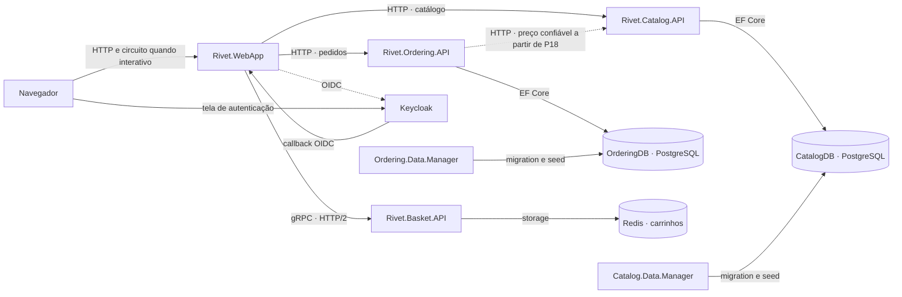

As setas contínuas de serviços representam a comunicação de negócio. OIDC não implica consulta ao IdP em cada requisição; APIs validam access tokens do emissor configurado. As bases CatalogDB e OrderingDB podem compartilhar um servidor PostgreSQL local sem compartilhar propriedade dos dados.

O AppHost descreve e inicia recursos; não funciona como gateway no caminho do navegador. ServiceDefaults fornece configuração técnica, não uma API remota de negócio.

## A2 — Dependências de projetos

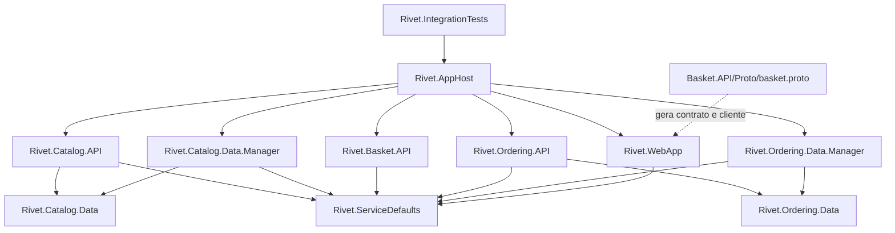

Aqui as setas representam referências de projeto ou o vínculo explícito ao contrato, não tráfego de rede. WebApp não referencia Catalog.Data/Ordering.Data. A integração de preço adicionada em P18 também é HTTP: não cria ProjectReference de Ordering.Data para Catalog.Data.

`Shared` será uma pasta de helpers pequenos compilados pelos managers conforme necessário, como no exemplo; não é um projeto de entidades compartilhadas entre os serviços.

## A3 — Estrutura física planejada

As pastas abaixo serão criadas quando a entrega correspondente precisar delas. Nomes e organização interna podem ser refinados com uma justificativa registrada, preservando os IDs dos passos.

```text
Rivet/
├── Rivet.slnx
├── global.json
├── Directory.Build.props
├── .editorconfig                         # convenções do Rivet, quando definidas
├── .gitignore
├── AGENTS.md
├── docs/
│   └── PLANO-DE-DESENVOLVIMENTO.md
├── src/
│   ├── Rivet.AppHost/                    # P06; recursos evoluem por entrega
│   │   ├── Program.cs
│   │   └── KeycloakResource.cs           # P10, se necessário à integração atual
│   ├── Rivet.ServiceDefaults/            # P06; configuração técnica
│   │   ├── HostingExtensions.cs
│   │   ├── OpenApiExtensions.cs
│   │   ├── ConfigurationExtensions.cs
│   │   ├── ServiceDiscoveryExtensions.cs
│   │   ├── AuthenticationExtensions.cs   # P10/P11
│   │   ├── ClaimsPrincipalExtensions.cs
│   │   └── HttpClientExtensions.cs
│   ├── Rivet.Catalog.API/                # P01
│   │   ├── Program.cs
│   │   ├── Apis/CatalogApi.cs
│   │   ├── Extensions/HostingExtensions.cs
│   │   ├── Model/
│   │   │   ├── CatalogServices.cs
│   │   │   ├── PaginationRequest.cs
│   │   │   └── PaginatedItems.cs
│   │   ├── CatalogOptions.cs
│   │   └── Pics/
│   ├── Rivet.Catalog.Data/               # P02
│   │   ├── CatalogBrand.cs
│   │   ├── CatalogType.cs
│   │   ├── CatalogItem.cs
│   │   ├── CatalogDbContext.cs
│   │   └── EntityConfigurations/
│   ├── Rivet.Catalog.Data.Manager/       # P02
│   │   ├── Program.cs
│   │   ├── CatalogContextSeed.cs
│   │   └── Migrations/
│   ├── Rivet.WebApp/                     # P07
│   │   ├── Program.cs
│   │   ├── Extensions/
│   │   ├── Components/
│   │   │   ├── App.razor
│   │   │   ├── Routes.razor
│   │   │   ├── Layout/
│   │   │   ├── Catalog/                 # contratos e componentes do catálogo
│   │   │   ├── Item/
│   │   │   └── Pages/
│   │   │       ├── Catalog/
│   │   │       ├── Item/
│   │   │       ├── User/
│   │   │       ├── Cart/
│   │   │       └── Checkout/
│   │   ├── Services/
│   │   │   ├── CatalogService.cs
│   │   │   ├── IProductImageUrlProvider.cs
│   │   │   ├── ProductImageUrlProvider.cs
│   │   │   ├── LogOutService.cs
│   │   │   ├── BasketService.cs
│   │   │   ├── BasketState.cs
│   │   │   ├── BasketItem.cs
│   │   │   ├── BasketCheckoutInfo.cs
│   │   │   └── OrderingService.cs
│   │   └── wwwroot/
│   ├── Keycloak/data/import/             # P10; sem credenciais reais
│   ├── Rivet.Basket.API/                 # P11
│   │   ├── Program.cs
│   │   ├── Proto/basket.proto
│   │   ├── Grpc/BasketService.cs
│   │   ├── Model/
│   │   ├── Storage/IBasketStore.cs
│   │   ├── Storage/RedisBasketStore.cs
│   │   └── Extensions/
│   ├── Rivet.Ordering.API/               # P15
│   │   ├── Program.cs
│   │   ├── Apis/OrdersApi.cs
│   │   ├── Model/
│   │   ├── Services/IIdentityService.cs
│   │   ├── Services/IdentityService.cs
│   │   ├── Services/OrderCreationService.cs # somente se extraído em P18
│   │   └── Extensions/
│   ├── Rivet.Ordering.Data/              # P15
│   │   ├── Order.cs
│   │   ├── OrderItem.cs
│   │   ├── Buyer.cs
│   │   ├── Address.cs
│   │   ├── ValueObject.cs
│   │   ├── PaymentMethod.cs              # pagamento fictício adaptado
│   │   ├── CardType.cs
│   │   ├── Enumeration.cs
│   │   ├── OrderStatus.cs
│   │   ├── OrderingDbContext.cs
│   │   ├── OrderRequest.cs               # complemento P19
│   │   └── EntityConfigurations/
│   ├── Rivet.Ordering.Data.Manager/      # P15
│   │   ├── Program.cs
│   │   ├── OrderingDbContextSeed.cs
│   │   └── Migrations/
│   ├── Shared/
│   │   ├── MigrateDbContextExtensions.cs
│   │   └── ActivityExtensions.cs
│   └── Rivet.IntegrationTests/           # P06; acompanha novas entregas
│       ├── Infrastructure/
│       ├── WebAppTests.cs
│       └── testes por comportamento
└── .github/workflows/ci.yml              # P24
```

Cada diretório de projeto contém seu `.csproj` e configurações pertinentes, omitidos acima para facilitar a leitura. Arquivos de infraestrutura/deployment em P26 serão produzidos pelo mecanismo escolhido e revisados: não definir uma pasta `infra` ou manifestos fictícios antes de confirmar o fluxo atual.

### Contratos HTTP que devem existir ao final da base

Base do catálogo: `/api/v1/catalog`.

| Método e rota | Função | Passo |
| --- | --- | --- |
| `GET /catalogbrands` | Marcas | P02 |
| `GET /catalogtypes` | Tipos | P02 |
| `GET /items` | Lista paginada | P03 |
| `GET /items/{id:int}` | Detalhe | P03 |
| `GET /items/by?ids=1&ids=2` | Consulta por IDs | P04 |
| `GET /items/by/{name:minlength(1)}` | Prefixo de nome | P04 |
| `GET /items/type/{typeId}/brand/{brandId?}` | Tipo e marca opcional | P04 |
| `GET /items/type/all/brand/{brandId:int?}` | Marca | P04 |
| `GET /items/{catalogItemId:int}/pic` | Imagem | P05 |
| `POST /api/v1/orders/` | Criar pedido autenticado | P15; reforços P18/P19 |
| `GET /api/v1/orders/` | Pedidos da identidade corrente | P15 |

As duas últimas rotas já incluem a base de pedidos, não devem ser prefixadas com a base de catálogo. Rotas públicas web: `/`, `/item/{itemId:int}` e `/product-images/{id}`. Rotas de identidade: `/user/login`, `/user/logout`. Rotas web protegidas: `/cart`, `/checkout` e `/user/orders`.

O contrato de carrinho é gRPC: `package BasketApi`, serviço `Basket`, métodos `GetBasket`, `UpdateBasket`, `DeleteBasket`. Caminho completo de um método: `/BasketApi.Basket/GetBasket`. Mensagens de request/response são geradas do `.proto`; UpdateBasket recebe itens com `product_id` e `quantity`. Não passar um BuyerId arbitrário para selecionar o carrinho de outra pessoa.

Em P20, como complemento explícito, o contrato passa a transportar a versão do carrinho e a versão esperada na exclusão; o store compara e exclui atomicamente. O `.proto` original tem request de exclusão vazio, portanto essa evolução precisa ser explicada e testada no cliente e no servidor.

## C1 — Classes do catálogo

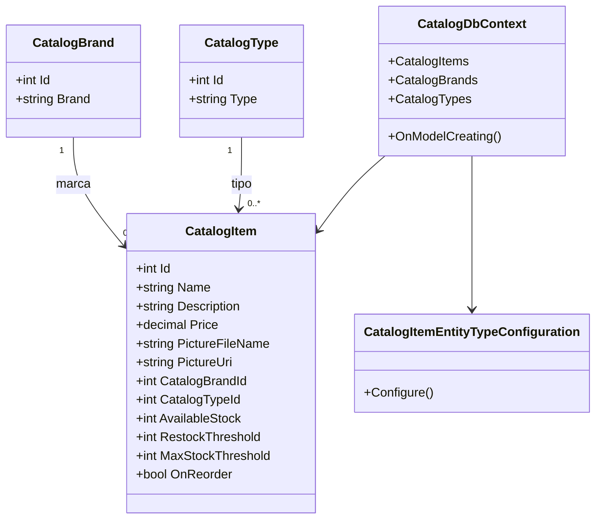

O diagrama resume campos e relações; navegações e DbSets completos serão explicados ao criar cada classe. Na referência, FK não anulável define associação obrigatória, mesmo com navegação C# anotada como nullable. `PictureUri` é calculada e não persistida; `virtual` sozinho não ativa lazy loading. Os records de resposta da WebApp são tipos de transporte próprios, mesmo quando repetem nomes das entidades.

## C2 — Carrinho, armazenamento e clientes

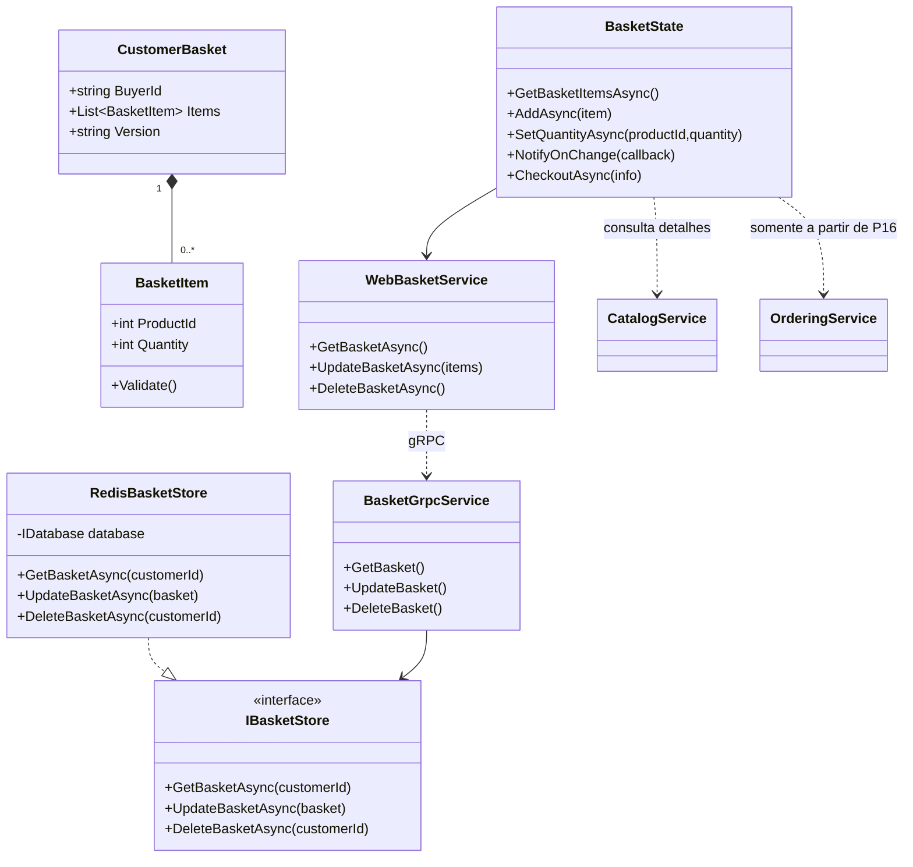

`BasketGrpcService` e `WebBasketService` são rótulos explicativos do diagrama; no código da referência ambos se chamam `BasketService`, em namespaces diferentes. O contrato protobuf possui seu próprio `BasketItem` só com ID/quantidade. O modelo de storage da referência tem campos adicionais; o transporte e a interface não precisam compartilhar sua classe.

A chave Redis é por identidade, como `/basket/{subject}`. No exemplo, UpdateBasket substitui o documento inteiro e não configura versão/TTL. Isso pode perder atualizações simultâneas de abas; P13 demonstra a limitação e a registra. O campo `Version` será acrescentado em P20 para proteger a limpeza após checkout; isso não é um controle otimista completo de todas as atualizações.

## C3 — Pedidos e pagamento fictício

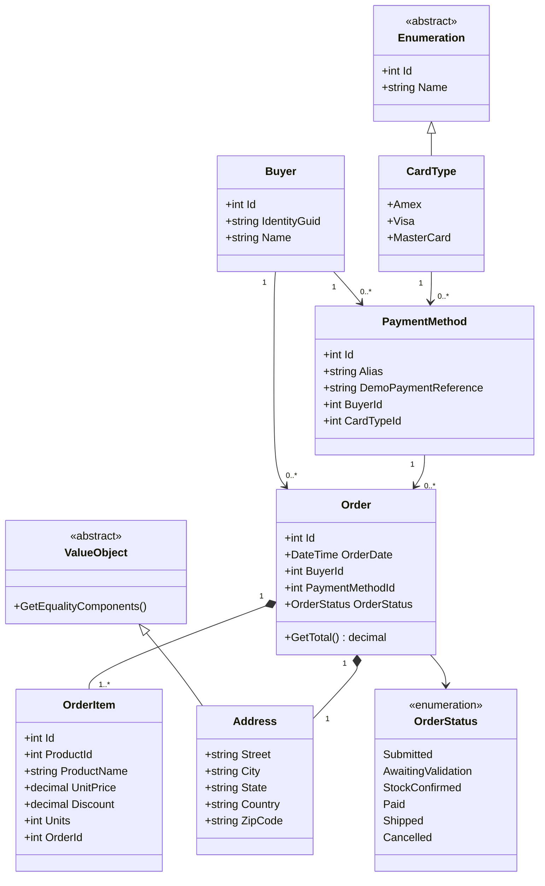

O diagrama é o **alvo do Rivet**, com pelo menos um item validado, associações obrigatórias no fluxo de criação e pagamento fictício adaptado. A referência permite coleção vazia e algumas FKs nullable; esses detalhes não serão copiados sem discussão.

`DemoPaymentReference` é complemento do Rivet em substituição aos campos sensíveis do original. `CardType` continua útil para estudar a classe de enumeração, sem representar uma autorização real de pagamento. O estado inicial do pedido é Submitted; não há motor de logística/cobrança que execute os demais estados automaticamente.

`OrderItem.ProductId` identifica um produto de outro contexto, mas não cria FK para CatalogDB. O pedido guarda o nome/preço confirmados no momento da compra. `Address` usa igualdade por valor e owned mapping. A estrutura não será chamada de agregado rico sem realmente proteger suas invariantes.

Contratos de entrada/saída: `CreateOrderRequest`, `OrderSummary` e o record web `OrderRecord`. `OrderServices` agrupa contexto e identidade; `IIdentityService` obtém a identidade do contexto autenticado.

## C4 — Identidade e contexto do usuário

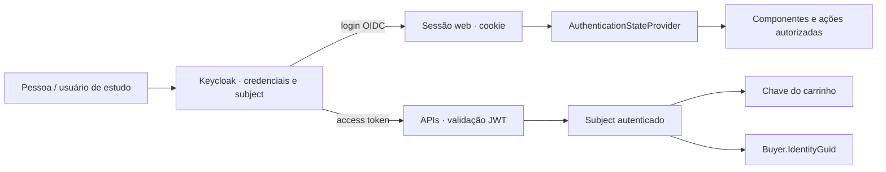

O token de acesso é enviado pelo cliente servidor para APIs, não utilizado como substituto do cookie em todas as interações do navegador. O armazenamento/propagação precisam respeitar SSR e circuito interativo: `HttpContext` não deve ser presumido válido em todo evento Blazor. Ocultar um botão não substitui autorização na API.

Microsoft Entra ID e identidade gerenciada Azure são assuntos relacionados de estudo, mas têm propósitos/configurações distintos. Trocar o IdP não é um requisito silencioso deste plano.

## C5 — Registro adicional de idempotência

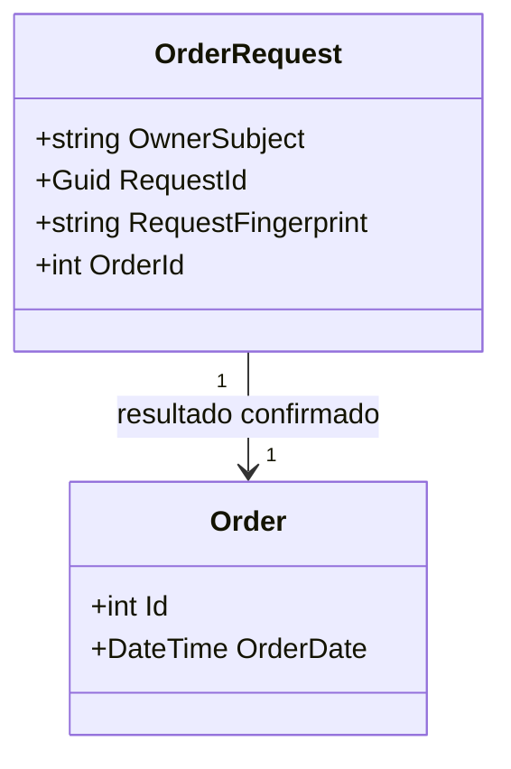

O diagrama representa um `Order` confirmado na transação. O registro de requisição é complemento de P19. Definir unicidade por identidade/chave e gravar associação/resultado atomicamente com o pedido. Durante processamento, a implementação pode precisar de campos/estados adicionais; isso será projetado e testado em P19.

O fingerprint usa uma representação canônica do conteúdo da solicitação. Uma repetição válida recupera o resultado original; não recalcula um novo pedido só porque o preço do catálogo mudou após a primeira confirmação. Duas requisições concorrentes precisam produzir um único resultado confirmado.

## F1 — Consulta de catálogo

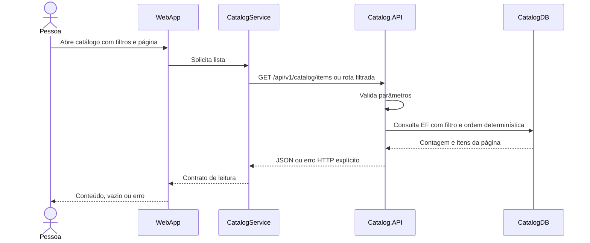

## F2 — Imagem de produto

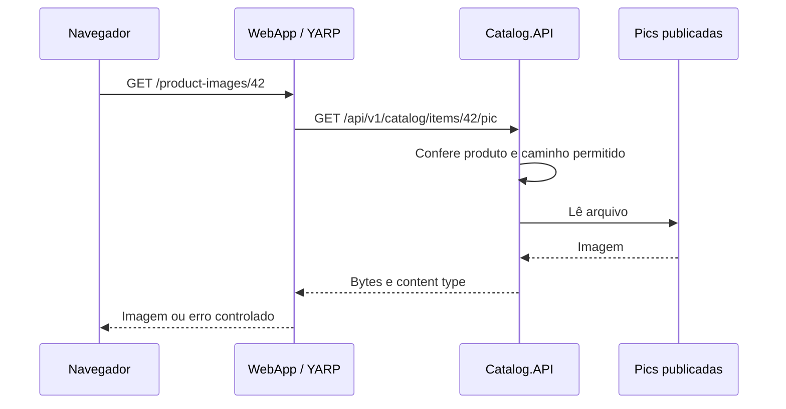

## F3 — Login e logout

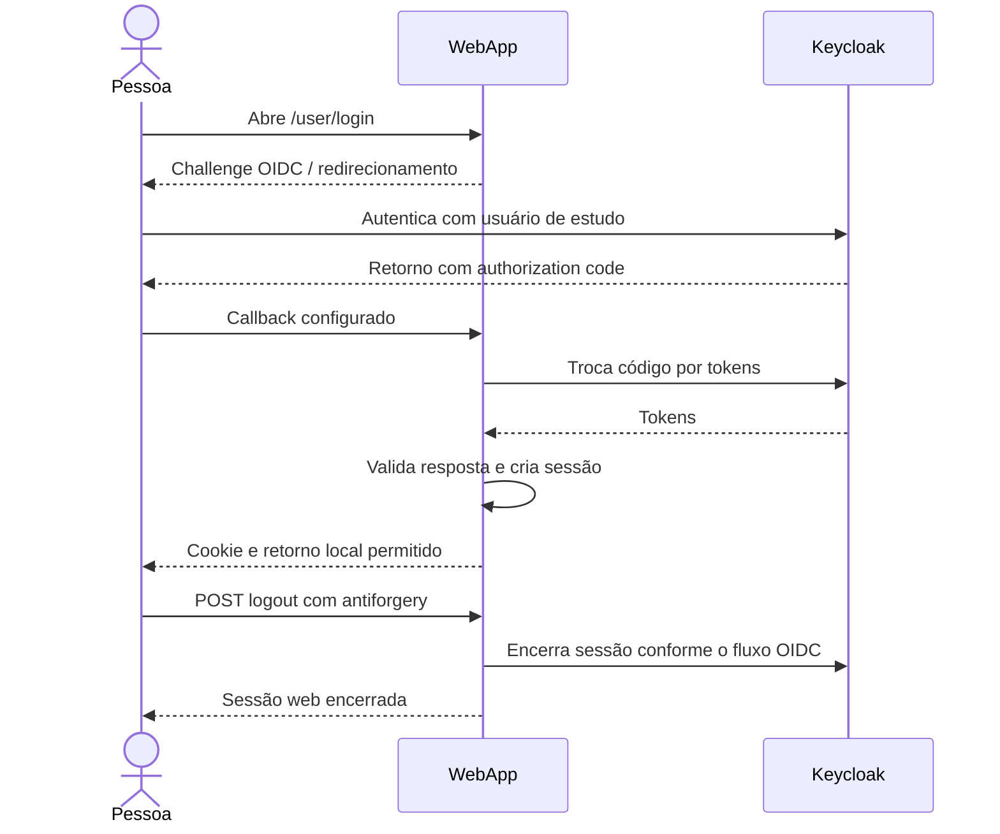

Detalhes como PKCE, proteção de estado/nonce, configuração de callbacks e transporte seguro serão explicados na implementação com a documentação da versão utilizada.

## F4 — Atualização do carrinho

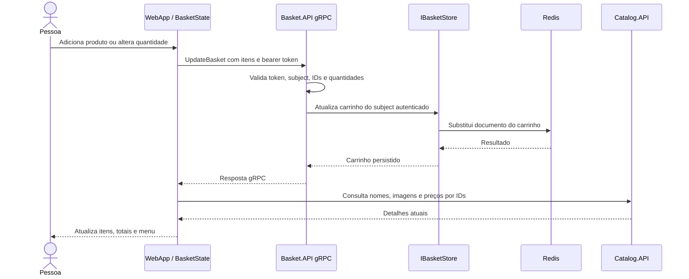

Falhas precisam ser refletidas na interface; não atualizar o estado como se o write remoto tivesse funcionado. Apagar o carrinho é um RPC separado. Preços exibidos no carrinho não substituem a confirmação do servidor na criação do pedido.

## F5 — Checkout funcional e histórico

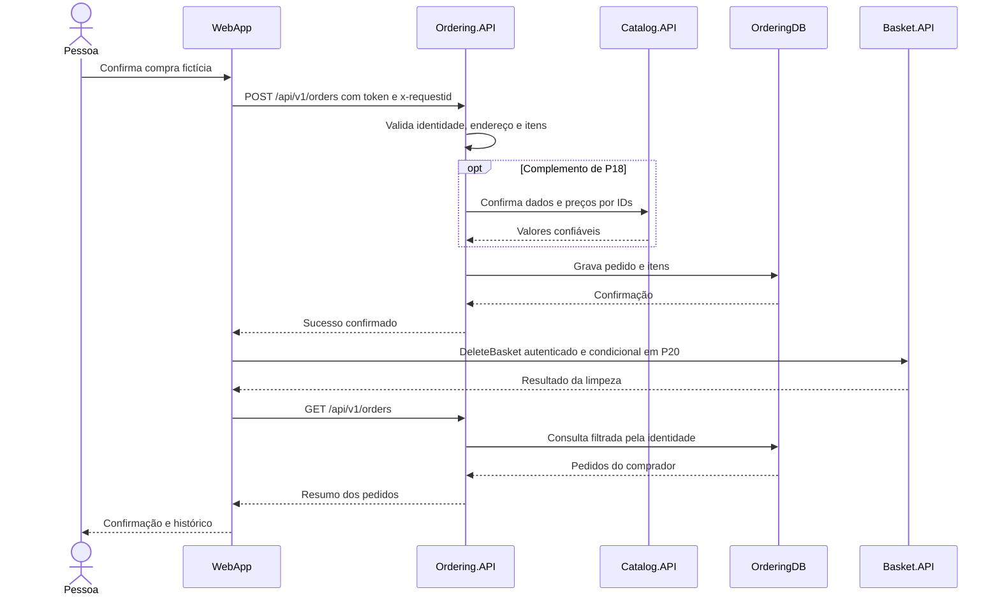

Antes de P19/P20, o fluxo já precisa verificar o sucesso HTTP e preservar carrinho em falha do POST. P19 acrescenta deduplicação; P20 acrescenta recuperação explícita quando o pedido foi confirmado e a limpeza falhou.

## F6 — Repetição e falha parcial

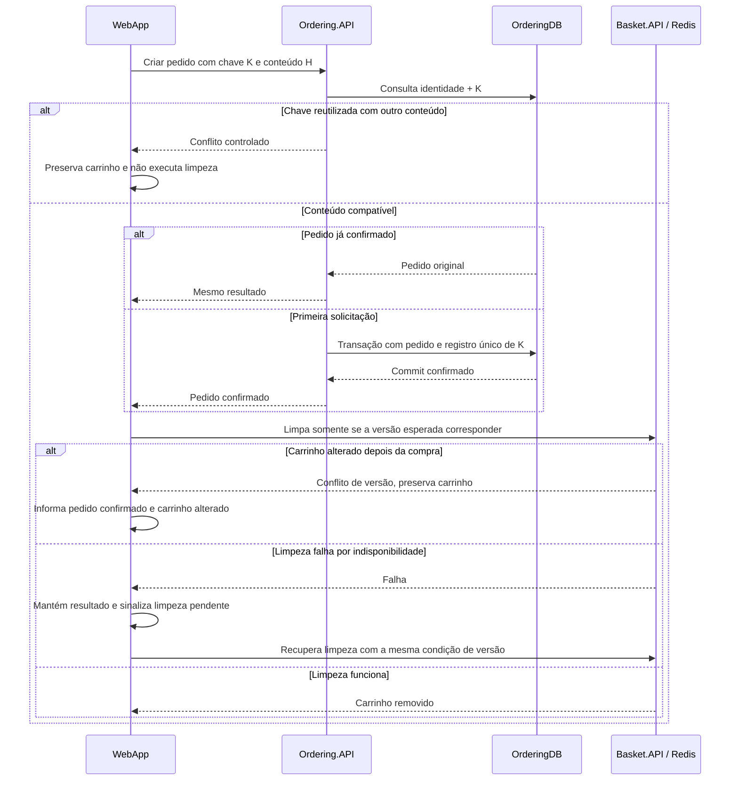

O desenho não é uma transação distribuída. A unicidade em banco precisa ser testada sob concorrência, não apenas com duas requisições sequenciais. Após confirmação, uma falha de transporte não autoriza gerar outra chave e outro pedido automaticamente.

## F7 — Rate limiting HTTP

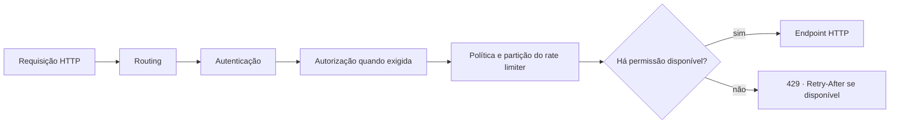

Este é um recorte do pipeline, não a lista completa de middleware. A política por endpoint exige routing anterior; partição por usuário depende de autenticação anterior. Configurar 429 explicitamente, pois o comportamento padrão não deve ser presumido. A escolha de fila/janela influencia o teste e a disponibilidade de Retry-After.

O limiter local mantém estado por processo/réplica. Quando houver escala, explicar essa fronteira; uma quota global pode exigir outro desenho. Rejeição de RPC gRPC é assunto separado, com semântica de status própria.

## A4 — Alvo de publicação no Azure

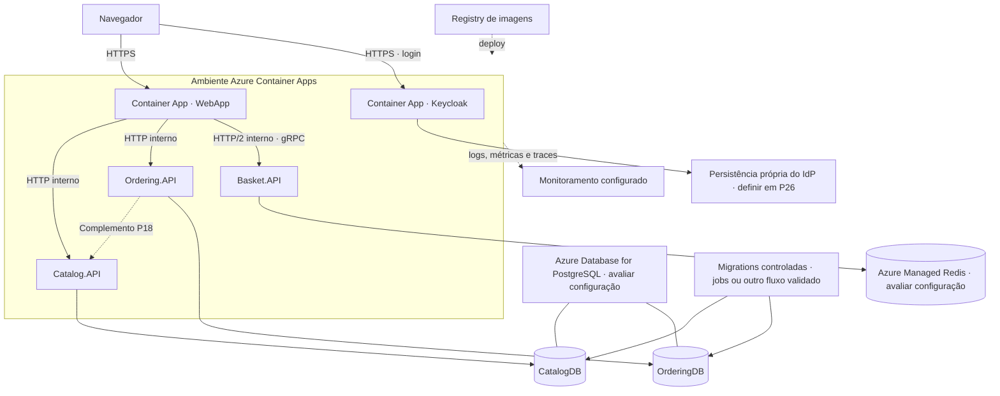

É um **alvo sujeito à validação em P26**, não um conjunto de recursos já provisionados. Componentes do IdP também precisam de configuração de rede/ambiente adequada. Container Apps é a opção planejada para estudar a composição; escolhas de SKU, região e mecanismo de deploy dependem da disponibilidade e das condições atuais.

Web/IdP precisam ser alcançados pelo navegador nos fluxos previstos. As APIs podem usar ingress interno. Basket exige HTTP/2; não basta presumir que qualquer ingress atende gRPC. Evitar `localhost` como endereço entre containers.

Assets do catálogo serão inicialmente publicados na imagem da API, com acesso consistente em todas as réplicas. Armazenamento Blob pode ser uma extensão de estudo futura; não é um serviço presente no workshop que precisa ser inventado agora.

Planejar antes de escalar: Data Protection, session affinity do Interactive Server quando aplicável, persistência do Keycloak, TLS, issuer público, segredos/conexões, readiness e migrations. O AppHost não é publicado como um servidor que precisa encaminhar todas as requisições da aplicação.

## Relação com a AZ-900

| Prática | Conceitos que vamos relacionar |
| --- | --- |
| Containers locais e ACA | Opções de computação e modelo de responsabilidade |
| Serviços com dados separados | Recursos, rede, endpoints e responsabilidade pelos dados |
| PostgreSQL/Redis gerenciados | Serviços gerenciados, disponibilidade e fatores de custo |
| Login e acesso às APIs | Identidade, autenticação e autorização; comparar com Entra sem trocar o IdP automaticamente |
| Telemetria e probes | Monitoramento e diagnóstico; comparação com Azure Monitor/Application Insights |
| IaC e ciclo de implantação | Resource Manager, grupos de recursos, governança e ferramentas de gerenciamento |
| Escala, revisão e remoção | Escalabilidade, confiabilidade, custos, tags e ciclo de vida |

Implementar esses recursos aprofunda desenvolvimento além do escopo conceitual da certificação. Os tópicos restantes da AZ-900 continuarão no Microsoft Learn, conforme o [guia oficial](https://learn.microsoft.com/credentials/certifications/resources/study-guides/az-900).
